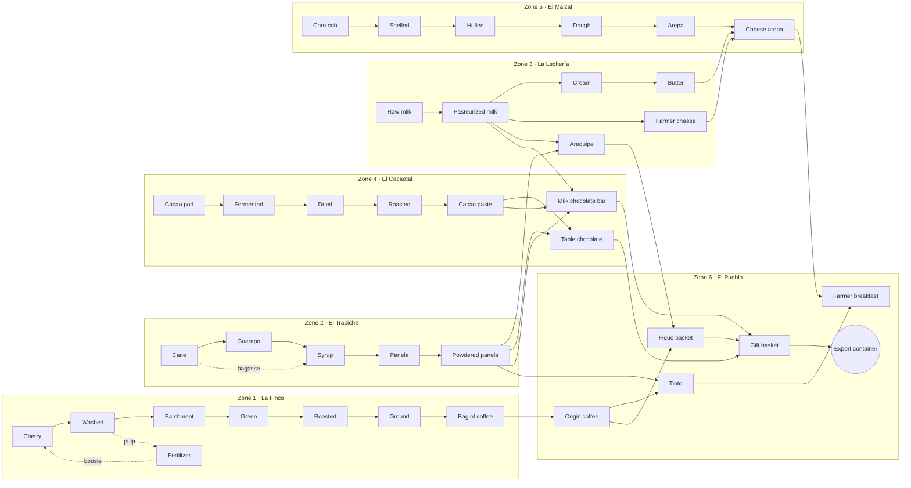

# Encantos de Mi Tierrita — Game Design Document (GDD)

> An educational, incremental **supply chain** game set in Colombia (it used to be called «Cafetal»): an unlimited but slow starting resource feeds a station, that station feeds the next one, and everything is upgraded to produce more and more.
> From the genre it only takes the visible production chain and the isometric «toy» art style, with characters carrying loads.
> There is no survival, no hostile weather, no population to feed, and no heroes.
> **Current state (v4.7.4):** a complete game with **10 regions**, **55 playable zones**, **360 stations**, **373 products**, **129 routes**, **4 languages** (`es`, `en`, `pt`, `fr`), **10 music pieces**, packaged for the web (PWA) and Android (**Capacitor 8**). Written in JavaScript (Vite + PixiJS).

---

## 1. Theme

We looked for a theme where a long transformation chain is **natural and easy to understand**, where every step **adds value** to the product, and where the source is **unlimited**.

| Theme | Unlimited source | Chain | Notes |
|------|------------------|--------|-------|
| **Cafetal** (mountain coffee farm) | Coffee trees (cherries) | cherry → washed → parchment → green → roasted → ground → bag | **Recommended**: a real 7-step chain, very visual and full of identity |
| Village bakery | Wheat field | wheat → flour → dough → bread → cake | Shorter, ideal for something very simple |
| Chocolate factory | Cacao grove | cacao → fermented → roasted → paste → bar → bonbon | Very similar to coffee; good as Zone 2 |
| Mining forge | Ore vein | ore → ingot → bar → part → tool | A more industrial tone |

**Cafetal is chosen** because:
- The real coffee chain has many steps with their own names, each with a recognizable building.
- The coffee landscape (green mountains, mist, colorful houses with balconies, tall palms, mules and loaded Willys jeeps) gives the art its own charming style.
- Expansions come naturally: a roastery in town, a café with drinks, an export port, cacao…

---

## 2. Concept

> *You inherit a hillside with a few coffee trees and a mule. Harvest, process and ship better and better coffee until you fill your first export container.*

- **Genre:** incremental / idle production chain.
- **View:** isometric. The farm runs down the hillside: the coffee field at the top and the town where goods are shipped at the bottom. The chain reads from top to bottom.
- **Sessions:** short (2 to 10 min) or left running. Offline earnings with a cap.
- **Zone 1:** 3 to 5 hours to the final goal. **It has an ending**: no waiting for days.
- **Without:** heroes, gacha, energy, ads or payments.

### Pillars
1. **Every product feeds the next one.** You can always see which station is waiting and which one is jamming.
2. **Upgrading is always noticeable.** Every purchase visibly speeds something up: more mules, faster machines, bigger numbers.
3. **The bottleneck moves.** Fix one and another appears further down. That is the game.
4. **Small and finished.**

---

## 3. Game loop

```
 Coffee field (unlimited, slow)
      │  cherries
      ▼
 Station 2 ─► Station 3 ─► … ─► Warehouse ─► Dispatch (Willys) ─► 💰 Coins
      ▲                                                             │
      └──────────── Upgrade level / mule drivers / unlock ◄─────────┘
```

1. The **coffee field** produces cherries endlessly, but slowly.
2. Each **station** turns what it receives into a higher-value product.
3. The **mule drivers** (mules) carry the product from one station to the next.
4. Everything that reaches the **Warehouse** is sold by **Dispatch** and becomes coins.
5. Coins are used to **upgrade**, **unlock** stations and buy **research**.

**Key decision:** do I upgrade production, transport or sales? The player looks for the bottleneck; the UI marks it.

---
## 4. The chain (Zone 1)

| # | Station | In | Out | Cycle (lv. 1) | Unit value | Unlock | Base upgrade cost |
|---|----------|-------|------|---------------|--------------|------------|----------------------|
| 1 | **Coffee field** ♾️ | — | 1 🍒 cherry | 2 s | 1 | Initial | 5 |
| 2 | Beneficiadero (pulping and washing) | 2 🍒 | 1 💧 washed bean | 4 s | 3 | 50 | 8 |
| 3 | Drying shed (marquesina) | 1 💧 | 1 🟫 parchment | 4 s | 6 | 250 | 12 |
| 4 | Huller | 1 🟫 | 1 🟢 green coffee | 4 s | 10 | 1,000 | 20 |
| 5 | Roaster | 2 🟢 | 1 🟤 roasted coffee | 8 s | 30 | 4,000 | 35 |
| 6 | Mill | 1 🟤 | 1 ☕ ground coffee | 8 s | 45 | 15,000 | 60 |
| 7 | Packer | 4 ☕ | 1 🛍️ bag of coffee | 32 s | 250 | 60,000 | 100 |
| — | **Warehouse + Dispatch** | any product | 💰 | 10 s trip | — | Initial | 10 |

> **Balance rule (v0.2):** at the same level, each station processes exactly what the previous one delivers (the cycles were computed from the coffee field's 0.5 🍒/s at level 1). So raising the whole chain together keeps the flow balanced, and the bottleneck appears when a station falls behind. Simulated: a player who raises the chain as a block builds the Packer at ~67 min; one who upgrades station by station, at ~2 h 20 min.

- **At first only the coffee field and Dispatch exist:** cherries sell for 1 💰. Unlocking the Beneficiadero makes each cherry more profitable, and so on.
- **Every step adds more value** than it consumes (2 🍒 = 2 → 1 💧 = 3), so processing always pays, **if the station can keep up**. If not, the surplus is also sold raw.
- **Automatic diversion:** if a station is full or blocked, its input is diverted to the Warehouse and sold as is. The chain never jams completely; it just yields less. The UI shows it with an orange diversion arrow.

---

## 4b. Full map of the chain (all zones)

> **Historical note:** the breakdown below is the founding design of the **first 6 zones** (the Eje Cafetero, completed in v1.5). With the regional expansions (§10.3) the game reached **10 regions** and **55 playable zones**.

### Summary in numbers (Eje Cafetero / initial design v1.5)

| Item | Amount |
|----------|----------|
| Zones | **6** |
| Unlimited sources | **5** (coffee field, cane field, pasture, cacao grove, corn field); the Pueblo has none |
| Products in total | **40** |
| Stations (production buildings) | **38** |
| By-products that boost other stations | 2 (pulp → fertilizer, bagasse) |
| Products combining several zones | 10 |
| The game's final product | **Export container** |
| Maximum depth (steps from a source to the end) | 10 (from the cherry to the container) |

### Current summary of the country (v4.7.4)

| Item | Amount |
|----------|----------|
| Playable regions | **10** (Eje Cafetero, Santander, La Costa, Boyacá, Los Llanos, Costa Pacífica, Amazonas, Tolima Grande, Cundinamarca and Bogotá) + San Andrés announced as a special zone |
| Playable zones | **55** (9 regions × 6 zones + Bogotá as a 52×52-tile network) |
| Stations | **360** |
| Products | **373** |
| Routes between zones | **129** (including **27 unlimited trucks** to Bogotá) |
| Research | **633** |
| Events | **61** (6 per region in the first 9 + 7 in Bogotá with *La Gran Feria*) |
| Sticker album | **60 pages** (**360 stickers** illustrated in code) |
| Achievements | **151** |
| Custom icons (`mitierrita-icons.woff2`) | **602** COLR glyphs |
| Music pieces and effects | **10** regional compositions + **17** kinds of station sound |
| Languages | **4** (`es`, `en`, `pt`, `fr`) |

### Overview



### Detail per zone

Values are indicative and will be tuned with the balance simulator. ⇄ marks a product imported from another zone.
#### Zone 1 · La Finca (coffee) — 8 stations, 9 products — **v1.0**
| # | Station | Input | Output | Value |
|---|----------|---------|--------|-------|
| 1 | Coffee field ♾️ | — | Coffee cherry | 1 |
| 2 | Beneficiadero | 2 cherries | Washed coffee + *pulp* | 3 |
| 3 | Drying shed | 1 washed | Parchment coffee | 6 |
| 4 | Huller | 1 parchment | Green coffee | 10 |
| 5 | Roaster | 2 green | Roasted coffee | 30 |
| 6 | Mill | 1 roasted | Ground coffee | 45 |
| 7 | Packer | 4 ground | Bag of coffee | 250 |
| 8 | Compost bin *(optional branch, v1.0)* | 4 pulp (by channel, no mules) | Compost → everything the Finca sells +30 % while there is some (1 compost per 8 washed coffees; it speeds up no station, so it does not unbalance the chain) | — |

#### Zone 2 · El Trapiche (cane and panela) — 5 stations, 6 products — **v1.1** ✅
Opens upon completing the Finca. Products are worth ×5 compared with the first draft because the zone starts with the Finca's economy (coins are shared and the Finca keeps producing). Same balance rule: at the same level, each station processes what the previous one delivers.

| # | Station | Input | Output | Cycle (lv. 1) | Value | Unlock | Base cost |
|---|----------|---------|--------|---------------|-------|------------|------------|
| 1 | Cane field ♾️ | — | Cane | 2 s | 10 | With the zone | 50 |
| 2 | Molienda (cane mill) | 1 cane | Guarapo + *bagasse* | 2 s | 25 | 5,000 | 80 |
| 3 | Hornilla (furnace) | 2 guarapo (+ bagasse: ×2 speed) | Syrup | 4 s | 60 | 25,000 | 120 |
| 4 | Gaveras (molds) | 2 syrup | Panela | 8 s | 150 | 80,000 | 200 |
| 5 | Pulverizer | 1 panela | Powdered panela | 8 s | 250 | 250,000 | 350 |

- **Bagasse**: the Molienda produces it (1 per cycle) and it goes straight to the Hornilla, which sits next to it. While the Hornilla has bagasse, it works ×2 and uses 1 per cycle.
- **Research**: Motorized trapiche (Molienda ×2), Fertilizer for the cane (cane field ×2), Chiva for the Trapiche (dispatch ×2), Steel gaveras (×2), Organic panela (+50 % value).
- **Ending**: «First panela shipment», sell 6,000 powdered panelas (15 objectives; 5,000 until v1.6).
- **Measured duration** (`npm run balance`, v1.3): about 35 min after completing the Finca (the Finca, which keeps producing, speeds it up a lot).

#### Zone 3 · La Lechería — 6 stations, 6 products — **v1.2** ✅
Opens upon completing the Trapiche. Products ×25 compared with the first draft (the Trapiche was ×5). It is the first zone with **branches**: pasteurized milk is split among the Quesera, the Descremadora and the Paila. At the same level, the Pasteurizadora gives a quarter to the Quesera, another to the Descremadora, another to the Paila and the last one to the Cacaotal's **Milk route** (v1.3), so the balance rule holds: with everything at the same level, nothing is left over. While a branch is missing, the leftover milk is sold unprocessed.

| # | Station | Input | Output | Cycle (lv. 1) | Value | Unlock | Base cost |
|---|----------|---------|--------|---------------|-------|------------|------------|
| 1 | Pasture and barn ♾️ | — | Raw milk | 2 s | 125 | With the zone | 250 |
| 2 | Pasteurizadora | 1 raw | Pasteurized milk | 2 s | 300 | 200,000 | 400 |
| 3 | Quesera *(branch, ¼ of the milk)* | 4 pasteurized | Farmer cheese | 32 s | 2,400 | 400,000 | 1,300 |
| 4 | Descremadora (skimmer) *(branch, ¼)* | 2 pasteurized | Cream | 16 s | 800 | 1,000,000 | 600 |
| 5 | Churn | 2 cream | Butter | 32 s | 2,000 | 2,000,000 | 900 |
| 6 | Arequipe paila *(branch, ¼)* | 4 pasteurized + 1 powdered panela ⇄ | Arequipe | 32 s | 4,000 | 4,000,000 | 2,000 |

- **Splitting**: the Pasteurizadora's mules take each load to the branch with the emptiest input (counting what is on the way); the one that works faster receives more, without the player splitting by hand. The load is sized for the trip to the farthest one. If a branch's input cannot take a whole load (it is below the Pasteurizadora's level), it is given what fits once half its input is free (since v1.7.11; before, it received nothing). This applies to any station.
- **The Milk route's quarter**: until the Cacaotal opens, it is sold as milk. It is not a diversion or a problem: it is not marked with ↪️, the Pasteurizadora's panel explains it and the chain (🔗) shows it separately. A branch is only marked as lagging if it processes less than its quarter.
- **First route between zones — the Panela route** (`src/data/routes.js`, `src/sim/routes.js`): a **Chiva** picks up powdered panela at the Trapiche's warehouse and takes it to the Paila (60 s round trip). It has its own level (the Paila's 🚌 tab): at the same level as the Paila it carries everything it uses (25 % more), counting its speed research. The Trapiche's Willys does not sell the panela the Chiva is waiting for. Without panela, the Paila waits; the rest of the Lechería is unaffected.
- **Research**: Mechanical milking and Plate pasteurizer (×2, as a pair), Centrifugal skimmer, Electric churn, Quality rennet, Copper paila (×2), Tanker truck (dispatch ×2), Double-cream cheese and Export arequipe (+50 %).
- **Ending**: «Arequipe for the whole town», sell 6,000 arequipes (17 objectives; 3,000 until v1.6).
- **Measured duration** (`npm run balance`, v1.3): about 2 h 20 min after completing the Trapiche.

#### Zone 4 · El Cacaotal (chocolate) — 7 stations, 7 products — **v1.3** ✅
Opens upon completing the Lechería. Products ×125 compared with the first draft. It is the first zone with **two imports**: the Trapiche's panela (for the Mesa and the Chocolatería) and the Lechería's milk (only for the Chocolatería). Cacao paste is split between the Mesa and the Chocolatería: at the same level, half each.

| # | Station | Input | Output | Cycle (lv. 1) | Value | Unlock | Base cost |
|---|----------|---------|--------|---------------|-------|------------|------------|
| 1 | Cacao grove ♾️ | — | Cacao pod | 2 s | 1,000 | With the zone | 1,500 |
| 2 | Fermentation boxes | 2 pods | Fermented cacao | 4 s | 2,500 | 2 M | 2,000 |
| 3 | Dryer | 1 fermented | Dried cacao | 4 s | 4,400 | 5 M | 3,000 |
| 4 | Cacao roaster | 1 dried | Roasted cacao | 4 s | 8,800 | 12 M | 4,500 |
| 5 | Cacao mill | 2 roasted | Cacao paste | 8 s | 22,000 | 30 M | 7,000 |
| 6 | Chocolate table *(branch, ½)* | 2 paste + 1 powdered panela ⇄ | Table chocolate | 32 s | 100,000 | 40 M | 10,000 |
| 7 | Chocolatería *(branch, ½)* | 2 paste + 1 powdered panela ⇄ + 4 pasteurized milk ⇄ | Milk chocolate bar | 32 s | 220,000 | 80 M | 16,000 |

- **Routes**: the **Panela route to the Cacaotal** supplies the Mesa and the Chocolatería (at their level, it carries what both use and splits each load by the room each one has left). The **Milk route** takes pasteurized milk from the Lechería's warehouse to the Chocolatería. Since the Trapiche already sends panela to the Lechería, the two panela routes split what there is according to what each one asks for.
- **Routes balance at the same level in every zone**, also at level 100 and with all research (there is a test): the panela the Paila, the Mesa and the Chocolatería ask for is ¾ of what the Trapiche makes (the rest is sold), and the Pasteurizadora keeps a quarter of its milk for the Milk route, like one more branch: its mules leave it in the warehouse, where the milk Chiva departs from. Before the Cacaotal opens, that quarter is sold as milk.
- **Research**: Fine clone grafts and Stepped boxes (×2, as a pair), Dryer with a sliding roof, Drum roaster, Ball mill, Aluminum molds, Tempering machine (×2), Truck for the Cacaotal (dispatch ×2) and Fine aroma cacao (everything the Cacaotal sells +50 %).
- **Ending**: «Chocolate for the fair», sell 4,000 milk chocolate bars (18 objectives; 3,000 until v1.6).
- **Measured duration** (`npm run balance`, v1.3): 1 h 45 min (attentive player) and 1 h 55 min (the one following the recommended upgrade) after completing the Lechería. Full game up to here: about 7 h.

#### Zone 5 · El Maizal (arepas) — 6 stations, 6 products — **v1.4** ✅
Opens upon completing the Cacaotal. Products ×1,000 compared with the first draft. A linear chain; the **Puesto de arepas** needs cheese and butter from the Lechería, which arrive by two routes. At the same level, the Puesto uses all the Quesera's cheese and all the Churn's butter (they are the Lechería's final products: what the Chiva does not take is sold).

| # | Station | Input | Output | Cycle (lv. 1) | Value | Unlock | Base cost |
|---|----------|---------|--------|---------------|-------|------------|------------|
| 1 | Corn field ♾️ | — | Corn cob | 2 s | 6,000 | With the zone | 20,000 |
| 2 | Sheller | 1 cob | Shelled corn | 2 s | 12,000 | 30 M | 25,000 |
| 3 | Huller (piladora) | 2 shelled | Hulled corn | 4 s | 30,000 | 80 M | 40,000 |
| 4 | Dough mill | 2 hulled | Corn dough | 8 s | 70,000 | 200 M | 60,000 |
| 5 | Budare (griddle) | 1 dough | Arepa | 8 s | 120,000 | 500 M | 90,000 |
| 6 | Puesto de arepas | 4 arepas + 1 cheese ⇄ + 1 butter ⇄ | Cheese arepas (platter) | 32 s | 1,200,000 | 600 M | 150,000 |

- **Routes**: the **Cheese route** and the **Butter route** leave the Lechería's warehouse (by the lower road) toward the Puesto.
- **Research**: Hybrid corn and Motorized sheller (×2, as a pair), Electric huller, Disc mill, Big budare, Double griddle (×2), Truck for the Maizal (dispatch ×2) and Grandma's recipe (everything the Maizal sells +50 %).
- **Ending**: «Arepas for the whole plaza!», sell 6,000 platters of cheese arepas (16 objectives; 3,000 until v1.6).
- **Measured duration** (`npm run balance`, v1.4): 1 h 45 min (attentive player) and 1 h 10 min (the one following the recommended upgrade) after completing the Cacaotal. Full game up to here: about 8 h 30 min.

#### Zone 6 · El Pueblo (final assembly, no source of its own) — 6 stations, 6 products — **v1.5** ✅
Opens upon completing the Maizal and is the last zone. It is the only one **without an unlimited resource**: everything arrives imported, and it is the «final exam» of the logistics between zones. Six routes, one from each zone: each supplying zone has **a final product nobody else takes** (at the same level, 1 every 32 s per level): the Finca's coffee bags, the quarter of panela the Trapiche had left over, the Lechería's arequipe, the Cacaotal's two chocolates and the Maizal's cheese arepas. At the same level in every zone, the Pueblo uses them exactly (there is a test).

| # | Station | Input | Output | Cycle (lv. 1) | Value | Unlock | Base cost |
|---|----------|---------|--------|---------------|-------|------------|------------|
| 1 | Casa del café (on the plaza) | 1 bag of coffee ⇄ | 2 origin coffee | 32 s | 150,000 | With the zone | 300,000 |
| 2 | Tinto greca | 1 origin coffee + 1 powdered panela ⇄ | 2 tintos | 32 s | 400,000 | 300 M | 400,000 |
| 3 | Fonda | 2 tintos + 1 cheese arepa ⇄ | Farmer breakfast | 32 s | 3,200,000 | 700 M | 600,000 |
| 4 | Basket workshop | 1 origin coffee + 1 arequipe ⇄ | Fique basket | 32 s | 600,000 | 1,500 M | 800,000 |
| 5 | Gift packing | 1 basket + 1 table chocolate ⇄ + 1 chocolate bar ⇄ | Gift basket | 32 s | 2,000,000 | 1,200 M | 1,000,000 |
| 6 | Container yard | 4 gift baskets | **Export container** | 128 s | 24,000,000 | 2,000 M | 1,500,000 |

- **Tree**: the Casa del café splits its origin coffee between the Greca (→ Fonda) and the Workshop (→ Packing → Container yard).
- **Changes from the first draft**: the draft had seven stations importing ground coffee, milk and cream, intermediate products already fully used in their zones; with them no zone balanced at the same level. Now the Pueblo only uses free final products, the café is summed up in the Greca and the Fonda, and the Pier is a Container yard (the town is in the mountains).
- **Research**: Expert tasters (Casa del café ×2), Two-tap greca, More tables at the Fonda, Fique weavers, Ribbons and bows, Container crane (×2 each), Tractor-trailer (dispatch ×2) and Designation of origin (everything the Pueblo sells +50 %).
- **End of the game**: «The village coffee travels the world!», export 7,000 containers (17 objectives; 1,000 until v1.6).
- **Measured duration** (`npm run balance`, v1.5): 2 h (attentive player) and 1 h 47 min (the one following the recommended upgrade) after completing the Maizal. Full game: about 11 h (attentive) and 10 h 15 min (casual).

### How products travel between zones
- Each zone has an **outgoing Warehouse**. Between zones there are **routes** with their own upgradable transport (the first one, v1.2's Panela route, uses a **chiva**).
- A route is set up like this: *product X, from Zone A to Zone B*. Like the mule drivers within a zone, the route has a capacity per minute and can be the bottleneck.
- **Each zone stays playable on its own:** if the import does not arrive, the stations that need it pause, but the rest of the chain produces and sells normally.
- **On completing a zone** the next one unlocks and the previous one keeps producing in the background, as if offline.

### Order of arrival (why this order)
1. **Finca:** a pure linear chain, teaches the basics.
2. **Trapiche:** introduces **by-products** (bagasse) and is the first supplier to other zones.
3. **Lechería:** introduces **branching** (one milk with 4 destinations) and the **first import** (arequipe).
4. **Cacaotal:** combines 2 and 3 imports in a single recipe.
5. **Maizal:** recipes with ingredients from several zones in the star product.
6. **Pueblo:** everything imported; it tests the whole network.

---
## 5. Upgrades

Each station has **two axes** of upgrades.

### 5.1 Production level (1–100)
- **Speed:** `speed(L) = base × (1 + 15/99 × (L − 1)) × milestones`. Milestones multiply: level 10 ×2, 25 ×2, 50 ×4, 75 ×4 and 100 ×8 (×512 in all; until v1.6 they were ×2 each). With 15/99 (≈ 0.1515) level 100 gives exactly ×8,192 (16 × 512), and since every cycle is a power of 2 (2, 4, 8, 16, 32 or 128 s), at level 100 every station produces a power of 2 per second: 4,096, 2,048, 1,024, 512, 256 or 64 (a test enforces it). The maximum level is 100.
- **Mastery and Supremacy (v1.7):** with every building of a zone at level 75 its Mastery can be researched (the whole zone, Willys included, produces ×4); with all at 100, its Supremacy (×8 more). Meant for the second ending.
- **Milestones** at levels 10, 25, 50, 75 and 100: speed **doubles** and the building changes its look (see §8).
- **Cost:** `cost(L) = baseCost × 1.15^(L − 1)`.
- Buy buttons ×1, ×10 and «max».

### 5.2 Mule drivers (transport to the next station)
- Each station has its own mules. A mule loads up, goes to the next station (or to the warehouse if the next one does not exist or its input is full), delivers and **comes back empty**.
- Mule drivers have their own **level (1–100)**, which costs half the station's:
  - **Mules** = 1 + one more every 10 levels (max. 10).
  - **Load per mule** (can have decimals): computed so the team moves **25 % more than the station produces at the same level**, counting the real distance to its normal destination and what speeds the station up (research, compost).
- **Simple rule for the player: mule drivers at the same level as their station = they carry everything.** If they are below, they are the bottleneck; Horseshoes and the Aerial cable give extra margin.
- Diversions to the warehouse use the same mules but the trip is longer, so they move less: they are an emergency resource, not a normal path.
- If all the mules are on the way, the product piles up in the **yard**. When it is full, the station stops (⛔).
- **«See chain» view (🔗)**: shows per station what it receives, processes and produces, and per stretch what the mule drivers carry, what is diverted and what is lost, with the bottleneck in red.

- **Conveyor belt (v1.2.3):** from transport level 50 (a milestone), the station's mules are replaced by a conveyor belt along the road. It carries exactly the same (the simulation does not change); on screen, what is on the way is boxes on the belt instead of mules with a driver, all drawn at once so that many advanced stations do not weigh down the animation.

### 5.3 Dispatch
- A **Willys** takes `N` units from the Warehouse to town and comes back. Capacity and speed can be upgraded and more jeeps bought (max. 5).
- It is the last bottleneck. At first it has room to spare; with 7 stations at a good level it becomes critical.

### 5.4 Research (one-time purchases, `src/data/research.js`)

**Rule:** every station of every chain has **exactly one** ×2 research (a test enforces it). Since **v2.3.2**, a station's ×2 becomes available when **that station and its mule drivers reach level 25** (the Compost bin, which has no mule drivers, only with its level); before, it appeared upon building the next station, and the «Appears with» column of the tables below is from then for those. The objectives that ask for a ×2 (Organic fertilizer, Motorized trapiche, Mechanical milking, Grafts, Hybrid corn and Tasters) moved to just after their zone's «everything at level 25» objective. With all of them bought, the chain stays as balanced as with none. «Second round» upgrades raise the price, not the speed: a second ×2 on a single station would leave the others always behind.

**La Finca**

| Research | Effect | Cost | Appears with |
|---------------|--------|-------|-------------|
| 🌱 Organic fertilizer | Coffee field ×2 | 300 | Beneficiadero |
| ⚡ Electric pulper | Beneficiadero ×2 | 400 | Beneficiadero |
| 🐴 Horseshoes | Mules ×1.5 speed | 900 | Drying shed |
| 🚙 Trailer for the Willys | Dispatch ×2 load | 2,500 | Huller |
| ♨️ Mechanical dryer | Drying shed ×2 | 6,000 | Huller |
| 🌀 Roller huller | Huller ×2 | 8,000 | Roaster |
| 🧑‍🌾 Foreman | Offline earnings: +3 h (the other zones have theirs: 24 h with all six) | 10,000 | Roaster |
| 🔥 Origin roast | Roasted coffee +50 % value | 20,000 | Roaster |
| 🔥 Big drum roaster | Roaster ×2 | 25,000 | Mill |
| 💧 Eco-friendly processing | Compost bin ×2 | 20,000 | Compost bin |
| 🌳 Castillo variety | Everything the Finca sells +50 % | 50,000 | Mill |
| ⚙️ Electric mill | Mill ×2 | 60,000 | Packer |
| 🚡 Aerial cable | Mules ×2 speed | 120,000 | Packer |
| 📦 Automatic packer | Packer ×2 | 150,000 | Packer |
| 🏅 Quality seal | Bags +50 % value | 300,000 | Packer |

**El Trapiche:** Motorized trapiche (Molienda ×2), Fertilizer for the cane (cane field ×2), Hornilla with more pans (×2), Chiva (dispatch ×2), Steel gaveras (×2), Electric pulverizer (×2), Organic panela (+50 % value).

### 5.5 Recommended upgrade
The notice at the top recommends the upgrade that adds the most 💰/s **at the end of the chain** (what comes out of the last built station) per coin spent, among stations, mule drivers and dispatch. What is sold diverted does not count: if it did, the recommendation would lead to raising mule drivers to sell raw material instead of completing the chain. It also recommends a **research** if the money is already there and it yields more than the best level (it never leaves the player saving up). Mule drivers, routes and the Compost bin are measured 10 levels at a time when a single level does not reach the minimum (very lagging mule drivers or the compost bonus add little level by level). If the zone receives something by a route, the stations of the sending zone count too: the recommendation can say «Mule drivers of the Pulverizer (El Trapiche)», and tapping it goes there. If no single upgrade yields anything, it tries mule drivers and routes two at a time (they can hold each other back, like the Milk route and the Chocolatería's mule drivers) and recommends the first of the best pair; failing that, the bottleneck. The «The chain» view keeps marking the bottleneck in red, unless it is already at level 100 (it cannot be upgraded further): then nothing is marked and the notice says what is left to build or that the zone is at the maximum.

### 5.6 Diversions and warehouse
What is diverted to the warehouse can only take up to 70 % of its capacity: the remaining 30 % always stays free for the chain's final product, so the cheap leftover product does not jam the Packer.

---

## 6. Objectives and the zone ending

A list of **29 objectives in order** (`src/data/goals.js`). 3 are shown at a time, the first one also in a tracker at the bottom left, and once met they are **collected** (they give coins). Kinds: sell or produce N of a product, raise something to a level, build a station, research, earn N 💰/s and raise every station to a level.

**Ending of Zone 1: «First big order»**, sell 2,000 bags of coffee (1,000 until v1.6). Collecting it shows the «Zone completed» screen with the stats and the announcement of Zone 2; free play can continue.

**Balance measured** with `npm run balance` (automated player, see `tools/balance-sim.js`):

| Player | Packer | Zone completed |
|---------|-----------|-----------------|
| Attentive: raises the whole chain together and picks the most profitable purchase | ~3 h | **~3 h 30 min** |
| Casual: follows the recommended upgrade and the objectives, saves up to build if it is close | ~3 h | **~3 h 20 min** |

(Measured in v1.0.1, after the mule drivers started keeping pace with their station.)

### Second ending: master coffee grower (v1.6)
After the Pueblo (or the last zone of each region), the objectives tracker shows the second ending: **bring every station, mule driver team and route of the region to level 100, collect all its objectives and buy all its research** (`masteryParts` in `src/sim/legacy.js`; originally the 38 stations of the first six zones). The first ending must have been achieved (since v1.7.12): you can have everything at 100 without having exported the 7,000 containers, and then the second ending comes upon collecting them, after the Pueblo screen. Achieving it shows the second-ending screen («Master coffee grower!» or its regional equivalent) with the game's stats and the option to **start the region over** (coins, levels, research and objectives from scratch) with **all production doubled**: ×2 after the first restart, ×4 after the second, ×8 after the third… (since v4.7.1, starting over is done from the second-ending card in Objectives, no longer from the menu). The multiplier is shown at the top below the recommended upgrade (v4.4.11); in v3.56 it went up to ×2³² and since **v3.68.3** it goes up to **×2⁶⁰ (60 restarts, ×1.15Qi)**: you can keep restarting (each restart still gives Renown and counts for achievements), but production no longer doubles. It doubles the speed of every station and what the Willys carries; mule drivers, routes, yards and inputs are computed from that, so at the same level everything still balances. Settings, seen notices, Renown purchases and the restart counter are kept.

Measured duration (`npm run balance`, v1.6; casual = follows the recommended upgrade, attentive = picks the most profitable purchase; after the Pueblo, both always raise whatever is furthest behind):

| Production | First ending (Pueblo), casual / attentive | Second ending (everything at 100), from the start |
|-----------|----------------------------------------|----------------------------------------------|
| ×1 (normal) | 10 h 16 min / 10 h 57 min | about 143 h (casual) |
| ×2 (1 restart) | 5 h 58 min / 4 h 32 min | 72 h / 74 h |
| ×4 (2 restarts) | 2 h 44 min / 2 h 41 min | 36 h / 36 h |
| ×8 (3 restarts) | 1 h 39 min / 1 h 28 min | 18 h / 19 h |

The second ending is long on purpose because of the formula: each level costs ×1.15 and the last 25 levels are worth much more than the income they add.

With the **workday and seasons (v1.9)**, uncompensated, in hours of play with the game open (at ×1, without restarts):

| Player | First ending, v1.8.5 → v1.9 | Second ending, v1.8.5 → v1.9 |
|---------|-----------------------------|------------------------------|
| Casual | 13 h 31 min → **27 h 07 min** | 27 h 36 min → **72 h 41 min** |
| Attentive | 14 h 50 min → **33 h 45 min** | 25 h 07 min → **51 h 37 min** |

With the ×2s at level 25 of the station and its mule drivers (**v2.3.3**): first ending 30 h 41 min (casual) and 25 h 31 min (attentive); second ending 58 h 26 min and 69 h 13 min. Per zone (casual / attentive): Finca 4 h 50 / 4 h 50, Trapiche 1 h 21 / 1 h 18, Lechería 4 h 00 / 4 h 16, Cacaotal 6 h 56 / 4 h 23, Maizal 5 h 57 / 3 h 14, Pueblo 7 h 38 / 7 h 29. (The bots vary quite a lot from one version to another in the Pueblo and the second ending: they decide differently depending on what they have.)

In v1.9, per zone (casual / attentive): Finca 5 h 06 / 4 h 35, Trapiche 1 h 22 / 1 h 19, Lechería 4 h 13 / 3 h 51, Cacaotal 7 h 14 / 4 h 41, Maizal 3 h 27 / 2 h 57 and Pueblo 5 h 47 / 16 h 22. In the Pueblo, the attentive bot barely researches until the end and takes a long time to export the 7,000 containers (that is the bot, not the game). With offline earnings (up to 24 h), real time is shorter.

## 7. Offline earnings

- On return, up to 2 h of play is really simulated; anything beyond that is added at the pace of the last simulated hour (coins, sales, production and imports). Always at normal speed: the sped-up time of the developer options only counts with the game open (since v1.8.1).
- **Cap**: 2 h, plus one research per zone that adds hours (since v1.8.1): Foreman (Finca) +3 h, Trusted trapiche worker +3 h, Scheduled milking +4 h, Cacao grove watchman +4 h, Neighbor who minds the budare +4 h and Pueblo administrator +4 h: **24 h** with all six.
- With the workday and seasons (v1.9), the simulated part already has its nights and seasons, and what is added beyond it is spread according to how much work happens in each stretch (nights do not count and each season yields its own; `workSeconds` in `src/sim/calendar.js`): it gives the same as playing live without simulating the 24 h.

While it computes, a loading screen shows a progress bar and how much time passed (v2.3.1: the computation goes in parts with `Game.catchUpAsync`). A welcome window shows what was earned and whether the cap was reached.

---
## 8. Art direction (isometric «toy» look, Colombian setting)

### What is taken from the genre
- Clean isometric view, with «toy» buildings, simple volumes, soft outlines and cast shadows.
- **Small life everywhere:** characters and animals walking with visible loads, moving machines, smoke and floating numbers.
- **Buildings grow with their level:** each milestone changes the model (shed → house → factory).
- Thick, friendly UI: rounded panels, big icons and bouncy buttons.

### Setting
- A green hillside on the diagonal, with the coffee field at the top and the town at the bottom. A zigzag dirt road joins the stations.
- Background: layered mountains with mist, tall wax palms and passing clouds.
- Stations are colorful farmhouses: white with a plinth, wooden doors and balconies painted red, blue, yellow or green, and clay roof tiles.
- **Mule drivers:** mules with sacks and a farmer in an aguadeño hat and poncho.
- **Dispatch:** a Willys jeep loaded to the top going down the road.
- Day and night: a misty dawn, a bright day and a night with warm lanterns and lit windows. Since v1.9, there is no work at night (§10.1).

### Visual evolution by milestone (implemented in v0.4)
Each station keeps its own drawing and gains details with each milestone:

| Milestone | Level | What changes |
|------|-------|------------|
| 1 | 10 | Flower pots and trims in another color |
| 2 | 25 | Second floor with a balcony (the Drying shed gains one more bed, the Mill's wheel grows) |
| 3 | 50 | Two lanterns that light up at night |
| 4 | 75 | Cobbled yard |
| 5 | 100 | The flag of Colombia waving on the roof and golden trims |

The coffee field's house evolves separately (from a wooden hut to a two-story house with a balcony).

### Day and night (v0.4)
- A day lasts 8 minutes of play; a new game starts at 8:00.
- The world is tinted (pink dawn, orange dusk, blue night) and the sky gradient changes. Stars, windows, lanterns, the Roaster's fire and fireflies glow at night.
- Until v1.8 it was only decorative. Since **v1.9** there is a workday (from 6:00 to 18:00; since v3.8, from 6:00 to 12:00 and from 14:00 to 20:00) and seasons (§10.1); the calendar is in `src/sim/calendar.js`.

### Sound (v0.4)
Synthesized with Web Audio, with no files: button clicks, coins when selling, an arpeggio on leveling up and crossing a milestone, hammering when building, birds by day and crickets at night. It can be turned off from the menu and the preference is saved with the game.

**On entering a station (v3.3.2)** its trade is heard: the **360 stations** and the warehouse are grouped into **17 sounds** (`STATION_SOUNDS` in `src/audio/Sound.js`): field, moo, water, engine, spinning, fire, boiling, wind, fermentation, knife, loom, boxes, ship horn, sizzle, cups, salt and the Willys. Since v3.66 the menu has separate volume controls for music (40 % by default) and effects.

**Music (v1.8.7, original):** each of the **10 regions** has its piece (`src/audio/songs.js`); the Eje Cafetero's is a **bambuco** in 3/4 (E minor and G major, 32 bars, 108 quarter notes per minute). The game builds it on start (`src/audio/compose.js`, about 0.3 s, bar by bar so it does not stutter) with Karplus-Strong strings: guitar bass and strumming on the first, second and third beats, muted tiple strokes on the offbeat and the bandola melody, with tremolo on long notes. It loops after the first tap, with room echo, fade in and out, pauses when the tab is hidden and has its own button in the menu. Also, since v3.71 the 10 pieces (MP3 and per-track MIDI) and the effects can be downloaded from `web/musica/` (`/musica/` on the web, outside the APK/AAB).

### Palette

| Use | Hex |
|-----|-----|
| Coffee field green (light) | `#7DBA4E` |
| Coffee field green (shade) | `#4E7F33` |
| Distant mountain | `#8FB3A0` → `#C9DCCF` (mist) |
| Red cherry | `#D7263D` |
| Roasted coffee | `#6B3E26` |
| Road dirt | `#C79A64` |
| Whitewashed wall | `#F4EFE6` |
| Roof tile | `#B5512E` |
| Balconies | `#2E6FD1` · `#E8B90F` · `#D7263D` · `#2FA36B` |
| Outline | `#3A2418` (60 %) |
| Day sky | `#BFE3F2` |
| Dusk | `#F6B26B` → `#E07A5F` |
| Night (tint) | `#2B2D5B` (multiply, 40 %) |
| Lantern | `#FFC864` (glow) |

### Visual rules
- **Tiles:** 64×32 px diamonds. Stations take up 3×3 tiles.
- **Shading:** top face = base, left = −15 % light, right = −30 %.
- **Characters:** 16×24 px, big head and a 3-frame walk; mules of 24×20 px with sacks of a different color for each product.
- **Effects:**
  - Floating «+250 💰» number when selling.
  - Coins jumping from the Willys when it reaches town.
  - Smoke in the roaster, steam in the beneficiadero and beans spread out in the drying shed.
  - A flash and a small bounce on leveling up; confetti and a model change at each milestone.
  - **Status indicators over each station:** ⏸️ waiting for input · ⛔ output full · ↪️ diverting to the warehouse. Since v1.7.8 they only show if the problem lasts: it takes up at least half of the last 10 s of play (30 s in v1.7.8) (waiting counts only in streaks of 8 s or more without input), and they go away when it drops below a fifth. With everything leveled, the product travels in batches and brief moments of a full yard or waiting are normal. The panel notice uses the same criterion. A full Compost bin is not marked (it is spare compost).
- **UI and interactions (updated to v4.7.4):**
  - Top bar: 💰 (tapping it opens **💰 Where it comes from**, `MoneyView.js`, with the breakdown by zone and multipliers) and 💰/s, clock/season and shortcuts to Map/Zones, Chain, Research, Events/Renown and Menu.
  - Bottom panel of the selected station: tabs ⚙️ Station, 🐴 Mule drivers and 🚌 Routes / Warehouse; buttons ×1 / ×10 / max.
  - Side: objectives and the tracker of the first collectible objective.
  - «See chain» button (`ChainView.js`): a flow diagram with **per-product colored** pipes (`pipeColors.js`), channels for by-products and multiple inputs, 📦 labels per station, the bottleneck in red and buttons at the bottom for **🏗️ Build** (builds in order whatever is affordable) and **⬆️ Everything to level X** (raises everything to the next milestone after the first restart, for 10 ⭐).
  - Map of Colombia (`ZoneMap.js`): zoom, real airports per region, animated travel by Willys and bush plane or **⚡ Direct** mode.
  - Bundled **Fredoka** font + the game's own COLR icon font **MiTierrita Icons** (**602 glyphs** in `src/data/icons.js`, with no external dependencies or system emojis that vary) and **360 album stickers** drawn in code, with descriptive tooltips (`iconTips.js`).
  - Buttons (v4.4.6): all the same height (50 px, that of a button with its text on two lines), with centered text.
  - Event board (v4.4.7): it collapses with ▾ to the row with the title, the clock and the progress bar (remembered on the phone); it opens with ▴ or by tapping the title, and only when pointing to the recommended upgrade.
  - Delete game (v4.3.2, v4.4.6): first the red button; tapping it shows the bar that is slid all the way to confirm, and if it is not slid within 8 s the button comes back.

### Producing the art without an artist
1. **v0.1–0.3:** everything was drawn with basic code (isometric boxes, gabled roofs, bushes).
2. **v0.4–v4.3+:** modular architecture in code (`Buildings.js`, `Terrain.js`, `EventArt.js`, `Album`, `tools/icons/build_icons.py`) with original illustrations for the 360 album stickers and 602 COLR icons that look the same on any device.

---

## 9. Technical architecture

- **Stack:** JavaScript (ES modules), Vite, PixiJS v8 and **Capacitor 8** for Android (`android/`).
- **No server:** saved in `localStorage` as versioned JSON, with a **file backup** (`src/backup.js`: download/open `.json` on the web and the native Share/Files sheet on mobile via `@capacitor/filesystem` and `@capacitor/share`).
- **Simulation and drawing are separate:**
  - The simulation advances at a fixed tick (10/s), is pure and is tested with Node (`npm test`).
  - Drawing (`src/render/`) only reads the state.
- **All content is data:** regions, zones, stations, products, routes, upgrades, research, objectives, events, album and achievements live in `src/data/`.
- **Languages (`src/i18n/`):** Spanish base with dynamic translations to **English (`en`), Portuguese (`pt`) and French (`fr`)**, articles and typographic rules per language, and verification scripts (`tools/i18n-*.mjs`, `test/i18n.test.js`).
- **Big numbers:** with `Number` up to the coin ceiling **`999Dc`** (`MAX_COINS = 999e33`, v3.68.3) and restart multipliers up to **`×2⁶⁰` (`×1.15Qi`)**. Formatted with a decimal comma or point depending on the language (`1.23K · 3.45M · 5.67B … Dc`).

### Folders

```
/
├─ index.html
├─ package.json                # scripts dev (port 3000), build, test, balance, android
├─ vite.config.js
├─ capacitor.config.json
├─ CHANGELOG.md                # release notes in English; CHANGELOG.es/pt/fr.md in the other languages
├─ .github/workflows/pages.yml # publishes the web, mitierrita.apk, mitierrita.aab and /musica/
├─ docs/GDD.md                 # design document
├─ public/                     # manifest, sw.js, PWA icons, privacy policy (es/en/pt/fr), Fredoka license
├─ store/                      # Google Play listings, screenshots and images in es/en/pt/fr
├─ web/musica/                 # downloadable MP3 and MIDI of the 10 regions and 31 effects
├─ tools/                      # balance-sim, event-bots/sim/idle, i18n-*, music/sfx-export, geo, icons
└─ src/
   ├─ main.js, boot.js         # startup, language loading, scene and HUD
   ├─ backup.js, native.js     # backup file/Share and Capacitor lifecycle
   ├─ tip.js, update.js        # Play/Ko-fi tips and the APK update notice
   ├─ core/                    # Game, EventBus, SaveSystem, format, path, rng
   ├─ sim/                     # pure simulation (stations, transport, dispatch, chain, routes,
   │                           # upgrades, goals, events, calendar, regions, legacy, logros, renown...)
   ├─ data/                    # 10 regions, zones/zone1..55, stations, products, routes,
   │                           # research, goals, events, album, logros, icons, colombiaMap, zoneGeo
   ├─ render/                  # PixiJS v8 (Scene, Buildings, Stations, Terrain, Belts, Carriers,
   │                           # Keeper, Pets, Critters, Weather, DayNight, Effects, EventArt, occlusion)
   ├─ ui/                      # HUD, StationPanel, ChainView, ZoneMap, ZonesView, MoneyView,
   │                           # GoalsView, EventsView, EventBar, RenownView, iconTips, calendar...
   ├─ audio/                   # compose.js, Music.js, Sound.js, songs.js (10 regional pieces)
   ├─ i18n/                    # apply.js, index.js, en/, pt/, fr/
   └─ assets/                  # Fredoka fonts and mitierrita-icons.woff2
```

### Data example

```js
// src/data/stations.js
export const STATIONS = [
  {
    id: 'farm', name: 'Cafetal', infinite: true,
    out: { cherry: 1 }, cycle: 2.0,
    unlockCost: 0, upgradeBase: 5,
    sprites: ['farm_0', 'farm_10', 'farm_25', 'farm_50', 'farm_75'],
  },
  {
    id: 'wetmill', name: 'Beneficiadero',
    in: { cherry: 2 }, out: { washed: 1 }, cycle: 3.0,
    unlockCost: 50, upgradeBase: 40,
  },
  // ...
];

export const MILESTONES = [10, 25, 50, 75, 100]; // ×2 speed at each one
export const COST_GROWTH = 1.15;
```

---
## 10. Roadmap

| Version | Content | Playable result |
|---------|-----------|-------------------|
| **v0.1** ✅ | Isometric map, camera, coffee field + Dispatch, level upgrade, coins HUD | Produce cherries, sell them and upgrade |
| **v0.2** ✅ | The 7 stations, recipes, buffers, diversion to the warehouse, unlocks | The full chain works |
| **v0.3** ✅ | Real mule drivers along the road, transport upgrades, Willys, status indicators, «See chain» view | Bottlenecks are visible |
| **v0.4** ✅ | Milestones with model changes, effects, cosmetic day and night, basic sound | It feels alive |
| **v0.5** ✅ | Objectives, research, saving, offline earnings, balance simulator | Playable from start to finish |
| **v1.0** | Export container, final screen and tuned balance | **Zone 1 complete** |
| v1.1 ✅ | **Zone 2: El Trapiche**: cane → panela; bagasse as fuel; several zones at once and a zone picker | Expansion |
| v1.2 ✅ | **Zone 3: La Lechería**: milk branching; **first route between zones** (the Trapiche's panela for the arequipe) | Expansion |
| v1.3 ✅ | **Zone 4: El Cacaotal**: table chocolate and chocolate bar; two imports at once and routes supplying several stations | Expansion |
| v1.4 ✅ | **Zone 5: El Maizal**: arepas and cheese arepas with the Lechería's cheese and butter | Expansion |
| v1.5 ✅ | **Zone 6: El Pueblo**: Casa del café, Greca, Fonda, gift baskets and the Export container (**end of the game**) | Final expansion |
| v1.6 ✅ | **Second ending**: everything at level 100; start over with production ×2, ×4, ×8… | Replayable |
| v1.7 ✅ | Stronger milestones (×2, ×2, ×4, ×4, ×8), **Mastery** ×4 and **Supremacy** ×8 per zone, longer final objectives | Reachable second ending |
| v1.8 ✅ | **Ambience**: real facts in the panels and one person per zone who points out what matters; life on the map (hens, a dog, cows, people, pigeons); sounds per zone; the chain as a diagram | More personality |
| v1.9 ✅ | **Workday and seasons** (§10.1): no work at night; dry season, start of the rains, rainy season and veranillo | Rhythm |
| v2.0 | **Events and badges** (§10.2): one event per zone per year, with medals; general progression that is not lost on restart | Long-term replayability |
| v3.0 ✅ | **Regions** (§10.3): Santander opens upon completing the Pueblo; its first zone, **La Guayabera** (bocadillo veleño), and its music (guabina) | More country |
| v3.1 ✅ | **El Tabacal** (hand-rolled tobacco), Santander's second zone | Santander grows |
| v3.2 ✅ | **La Fiquera** (sacks, espadrilles and tobacco bundles), with Santander's first route: the tobacco one, from the Tabacal | Santander grows |
| v3.3 ✅ | **El Hato** (air-dried meat, lunch and fiambre), with the bocadillo (Guayabera) and fique (Fiquera) routes | Santander grows |
| v3.4 ✅ | **Las Hormigas** (hormiga culona, harvested only at the start of the rains), with the sacks and espadrilles routes (Fiquera) | Santander grows |
| v3.5 ✅ | **Barichara**, Santander's last zone (like the Pueblo: it receives what the other five make and turns it into tours along the Camino Real to Guane) | Santander complete |
| v3.15 ✅ | **La Costa** opens upon completing Barichara; its first zone, **El Arrozal** (rice from Montería and Mompox), and its music (cumbia) | More country |
| v3.16 ✅ | **El Cocal** (coconut → coconut milk → cocadas), the Costa's second zone | La Costa grows |
| v3.17 ✅ | **La Ciénaga** (bocachico: salted fish, fried with patacón and in coconut), with the Costa's first route: coconut milk, from the Cocal | La Costa grows |
| v3.18 ✅ | **La Quesera** (queso costeño and mote de queso: almuerzo costeño and bandeja costeña), with the rice (Arrozal) and fish (Ciénaga) routes | La Costa grows |
| v3.19 ✅ | **El Sombrero** (caña flecha → braid → sombrero vueltiao; the Tuchín stop), with the salted fish and fried fish routes (Ciénaga) | La Costa grows |
| v3.20 ✅ | **Cartagena**, the Costa's last zone (like Barichara: it receives what the other five make and turns it into trips to the Rosario Islands) | La Costa complete |
| v3.21 ✅ | La Costa complete: its 6 events, its album, its achievements and its second ending | La Costa complete |
| v3.22 ✅ | **Boyacá** opens upon completing Cartagena; its first zone, **El Papal** (papitas criollas), and its music (torbellino) | More country |
| v3.23 ✅ | **La Cervecería** (barley → malt → wort → beer → crate), Boyacá's second zone | Boyacá grows |
| v3.24 ✅ | **Ráquira** (pots, painted planters and clay jugs of beer), with Boyacá's first route: the beer one, from the Cervecería | Boyacá grows |
| v3.25 ✅ | **Paipa** (Paipa cheese, almojábanas, piquete and a basket of amasijos), with the potatoes (Papal) and clay (Ráquira) routes | Boyacá grows |
| v3.26 ✅ | **Las Ruanas** (sheep → wool → ruana; the Nobsa shop), with the pots and planters routes (Ráquira) | Boyacá grows |
| v3.27 ✅ | **Villa de Leyva**, Boyacá's last zone (like Barichara and Cartagena: it receives what the other five make and turns it into trips to the Fossil) | Boyacá complete |
| v3.28 ✅ | Boyacá complete: its 6 events, its album, its achievements and its second ending | Boyacá complete |
| v3.29 ✅ | **The Vélez plaza** in the middle of the Guayabera, with its one-tower church and bells; the mules go around it in the same times. Cats at 10 ⭐ and parrots at 8 ⭐ | More personality |
| v3.30 ✅ | **Fewer events**: 2 slots for the whole game (never from the same region) and a 2-year wait; pause, restart and finish inside the event, and keep looking at it after winning | Rhythm |
| v3.31 ✅ | **Los Llanos** open upon completing Villa de Leyva; their first zone, **La Palma** (palm oil), and their music (joropo) | More country |
| v3.32 ✅ | **El Frutal** (passion fruit → pulp → pasteurized pulp → juice → box of juices), the Llanos' second zone | Los Llanos grow |
| v3.33 ✅ | **La Cachamera** (pisillo, smoked cachama and cachama with passion fruit), with the Llanos' first route: the juice one, from the Frutal | Los Llanos grow |
| v3.34 ✅ | **El Hato llanero** (mamona a la vara, carne a la llanera, almuerzo llanero and the parranda roast), with the oil (Palma) and cachama (Cachamera) routes | Los Llanos grow |
| v3.35 ✅ | **La Talabartería** (leather → saddle; the Llano souvenir), with the pisillo and smoked cachama routes (Cachamera) | Los Llanos grow |
| v3.36 ✅ | **Villavicencio**, the Llanos' last zone (like Villa de Leyva: it receives what the other five make and turns it into trips to Caño Cristales) | Los Llanos complete |
| v3.37 ✅ | Los Llanos complete: their 6 events, their album, their achievements and their second ending | Los Llanos complete |
| v3.38 ✅ | **La Costa Pacífica** (released as «el Chocó») opens upon completing Villavicencio; its first zone, **El Platanal** (patacones), and its music (chirimía) | More country |
| v3.39 ✅ | **La Azotea** (rooftop herbs → washed → crushed in the mortar → seasoning → box of seasoning), the Costa Pacífica's second zone; the region is renamed | La Costa Pacífica grows |
| v3.40 ✅ | **La Bahía** (red snapper: dried, smoked and tapao), with the Costa Pacífica's first route: the seasoning one, from the Azotea | La Costa Pacífica grows |
| v3.41 ✅ | **El Manglar** (piangua: rice with piangua and seafood cazuela), with the patacones (Platanal) and snapper (Bahía) routes | La Costa Pacífica grows |
| v3.42 ✅ | **El Werregue** (fiber → dyed → thread → vase; the Pacific souvenir), with the dried fish and smoked snapper routes (Bahía) | La Costa Pacífica grows |
| v3.43 ✅ | **Buenaventura**, the Costa Pacífica's last zone (like Villavicencio: it receives what the other five make and turns it into whale-watching trips) | La Costa Pacífica complete |
| v3.44 ✅ | La Costa Pacífica complete: its 6 events, its album, its achievements and its second ending | La Costa Pacífica complete |
| v3.45 ✅ | **Walled Cartagena by the sea**: the Caribbean, the beach, the wall with sentry boxes, the gates and the Clock Tower (drawing only) | More personality |
| v3.47 ✅ | **El Amazonas** opens upon completing Buenaventura; its first zone, **El Asaizal** (açaí), and its music (Amazonian cumbia) | More country |
| v3.48 ✅ | **El Ajizal** (chili → washed → ground → black chili in tucupí → box), the Amazonas' second zone | El Amazonas grows |
| v3.49 ✅ | **El Lago** (pirarucú: salted, smoked and with black chili), with the Black chili route | El Amazonas grows |
| v3.50 ✅ | **La Casabería** (bitter cassava → casabe; Amazonian breakfast and the maloca banquet), with the açaí and pirarucú routes | El Amazonas grows |
| v3.51 ✅ | **La Yanchama** (yanchama bark → beaten cloth → painted → Ticuna mask; the shop sells the Amazon souvenir), with the salted and smoked pirarucú routes | El Amazonas grows |
| v3.52 ✅ | **Leticia** (the Amazonas' ending: ice cream shop, restaurant, jungle hotel, port market, canoe provisions and pink dolphin trips), with six routes | El Amazonas grows |
| v3.53 ✅ | **El Amazonas complete**: its six events (the very tall palms, the drought, the end of the closed season, the low water, the Pelazón and the Confraternity Festival), its album and its achievements | El Amazonas grows |
| v3.54 ✅ | Collapsible regions in the zone picker; the Pacific Ocean with humpback whales behind Buenaventura | Navigation and life on the map |
| v3.55 ✅ | «Zone at the maximum» only with everything at the maximum level; otherwise, the suggestion says what is left to raise | Clarity |
| v3.56 ✅ | Restart cap: production goes up to ×2³² (32 restarts); you can keep restarting, but it no longer doubles | Balance |
| v3.57 ✅ | Multiplier with K, M, B; objectives: the real number of collectible ones and «Collect all» (without the ending); research: the zone's «Buy all», from cheapest to most expensive (without Mastery or Supremacy); both buttons at the bottom, outside the list | Convenience |
| v3.58 ✅ | The Compost bin not built: the Finca is not at the maximum («Next: build the Compost bin») | Clarity |
| v3.59 ✅ | Zone picker: each region in a shaded panel, with its zones inside and narrower | Navigation |
| v4.0 ✅ | **Tolima Grande** complete (six zones, sanjuanero, events, album and achievements); stations with two products (`by`, by channel to another station, to one that joins it or to a route) and stations that join two products of their zone (`joins`); the changes in Paipa, the Quesera, the Palma, the Hato llanero and the Cervecería; a zero-leak test at the maximum in every region (`test/maxflow.test.js`); zoom on the map of Colombia | More country and richer chains |
| v3.60 ✅ | Map of Colombia in the zone picker: the country with the regions in color, zooming into each region with its zones in their towns, and a little figure that walks to the chosen zone (`src/ui/ZoneMap.js`, `src/data/colombiaMap.js` generated by `tools/geo/build_map.py`, `src/data/zoneGeo.js`) | Navigation |
| v3.61 ✅ | Objectives to sell something another station consumes count what is produced (they say «Produce»): with that station built, the objective no longer stands still | Clarity |
| v3.62 ✅ | New name, «Encantos de Mi Tierrita», with its icon (the map of Colombia with a sombrero vueltiao, a palm, coffee and cacao) and identifier `com.frealgagu.mitierrita.encantos`; a Google Play version (AAB, without its own update notice) signed with an upload key that lives only in the secrets | Publishing |
| v3.63 ✅ | ☕ Buy me a tinto (only in the Play version): a voluntary tip with Google's billing (tinto, arepa, lunch; consumables), with no in-game prize and behind an adult gate; on the web, Ko-fi when it exists | Publishing |
| v3.64 ✅ | Privacy policy (web and a summary in ⚙️), the Fredoka font inside the game (no external connections) and the Google Play listing (`store/`: texts, screenshots and forms) | Publishing |
| v3.65 ✅ | Traditions told with care (Families policy): unlit hand-rolled tobacco, drink stickers about how they are made, the Uitoto without coca | Publishing |
| v3.66 ✅ | What the testers asked for: each icon's name when tapped, the warehouse by product (Dispatch tab), each station's 📦 label in the chain, music and sound volume (music at 40 %) and the regions in «How to play» | Clarity |
| v3.67 ✅ | The map first (region and zone highlighted, animated travel between zones and regions, Tolima and Bogotá «Coming soon»); regions without leaks at the maximum (×1.5 the first zone and ×1.25 the second); menu with About; tapping outside closes; full objectives; collapsible events and the exact route on the board; ⏸️ Pause or 🚪 Leave events (it keeps running in the background) and their clock up to 999:59 | Clarity |
| v3.68 ✅ | Languages: the game in English (picker in the menu; the first time, the phone's language). Base in `src/i18n`: the interface goes through `t('phrase in Spanish')` and each language brings its dictionary; content is translated by id (`src/i18n/<language>/content`) and laid over the data on startup (`src/boot.js`). Tools: `tools/i18n-code.mjs`, `tools/i18n-html.mjs` and `tools/i18n-skeleton.mjs` list what is missing; `test/i18n.test.js` enforces it. Portuguese and French follow | Reach |
| v3.68.3 ✅ | Restart cap at ×2⁶⁰ (60 restarts, ×1.15Qi) and coin ceiling at 999Dc (`MAX_COINS`, `capCoins`): with a region at the maximum it is reached in about 90 real days without stopping | Balance |
| v3.69 ✅ | Brazilian Portuguese (`src/i18n/pt`, the same parts as English). Zone and region names go without an article, like place names («vindo de Leiteria»), and the article of stations, routes and seasons comes from `ptArticle` («o Despolpador», «as Tecelãs»); what slows things down in an event already carries its contraction («por causa da broca»). Whatever has a name in Brazil is called that (rapadura, goiabada, beiju, açaí); decimal comma | Languages |
| v3.70 ✅ | French (`src/i18n/fr`, the same parts as Portuguese). Article with `frArticle` («le Dépulpeur», «l’Écrémeuse», «les Tisserandes»; words in -age, masculine, and a few exceptions in lists); zones and regions without an article; what slows things down in an event already carries its contraction («à cause du scolyte»). In `fr/index.js` the spaces before ! ? : ; and inside « » become non-breaking. Italian, Catalan and Galician stay in Spanish | Languages |
| v3.71 ✅ | Music and effects to download (`web/musica`, published at ./musica/ only on the web, not in the APK/AAB). `tools/music-export.mjs`: each piece in Node with `compose.js` (which now tags each note with its voice, without changing the sound) and Music.js's room echo through ffmpeg (`afir`, with a ConvolverNode's normalization) → MP3; and format-1 MIDI (`tools/midi.mjs`): one track per instrument, percussion on channel 10, a 1/24-beat grid. `tools/sfx-export.mjs`: Sound.js's effects recorded in Chromium with OfflineAudioContext → MP3, and the note-based ones in MIDI. `tools/music-page.mjs` builds the page in the four languages; pages.yml builds the .zip | Downloads |
| v3.72 ✅ | One challenge per event (`objective`, with a `type`): the six of each region, by the position of their zone, are `cadena`, `arranque`, `feria`, `ramas`, `corte` and `final` (`OBJECTIVE_TYPES`); the already-calibrated challenge of that type was kept among the three each event had. Boards in play from before (without `event.single`) end with their old challenge (`sim/legacyObjectives.js`). Slots: never played → without gold → with gold; among equals, the one unplayed the longest. Restarting a region opens it (`startZone`) | Events |
| v4.0 ✅ | **Tolima Grande** complete (six zones, sanjuanero, events, album and achievements); stations with two products (`by`, by channel to another station, to one that joins it or to a route) and stations that join two products of their zone (`joins`); the changes in Paipa, the Quesera, the Palma, the Hato llanero and the Cervecería; a zero-leak test at the maximum in every region (`test/maxflow.test.js`); zoom on the map of Colombia | More country and richer chains |
| v4.0.1–v4.0.3 ✅ | Restart cap at 60 (`×2⁶⁰`), the map opening directly on the region, per-product colored pipes in the chain, cats at 5 ⭐ and a map tap fix | Balance and smoothness |
| v4.1 ✅ | **Build and raise along the chain** (**🏗️ Build**, **⬆️ Everything to level X**), **💰 Where it comes from** (`MoneyView.js`), travel by **Willys and bush plane** on the map of Colombia, Salento with an **Export dispatch** (by truck to Buenaventura) and the **⚡ Direct** travel option | Convenience and a living map |
| v4.2 ✅ | **More frequent chivas** (every 30 s for 10 ⭐ and every 15 s for 20 ⭐ per region after filling the album and restarting once) | Rhythm |
| v4.3 ✅ | **Original drawings in the whole game** (360 album stickers and 602 original COLR icons without the phone's emojis), belts by colored stretches, the second Willys clarified, **delete game by sliding** and events calibrated with a guaranteed minimum | Visual identity and safety |
| v4.4 ✅ | **Cundinamarca** complete (Las Flores de la Sabana, Los Freseros de Sibaté, Las Truchas de Guatavita, Las Salinas de Nemocón, La Cocina de la Sabana and Zipaquirá with its Salt Cathedral), its **Pasillo de la Sabana**, its 6 events, its album and its achievements; a collapsible event board (`v4.4.7`), even buttons, real airports and the bush plane when getting close | More country and mobile |
| v4.5–v4.7.2 ✅ | **Bogotá** (`zone55_bogota.js`): a single 52×52 zone as a **network** (`network: true`) with 24 stations, **27 trucks** (`unlimited`) from the other nine regions, three by-products, **TransMilenio**, **Danza de La Candelaria**, 6 neighborhood events + **🎪 La Gran Feria** (`v4.7`), depth ordering of roofs/vehicles, the **⭐ Special zone** announcement (San Andrés) and restarting from Objectives | The great finale of the mainland |
| v4.7.3 ✅ | **🔁 Events on demand** (20 ⭐ per region once all its events have gold, to play any of them without a slot or the 2-year wait), a clock on event buttons and the `⬆ Everything to 50` indicator on won ones | Replayability |
| v4.7.4 ✅ | **💾 File backup** (`src/backup.js` with `@capacitor/filesystem` and `@capacitor/share` to save to files/Drive and open on another device) | Safe backup |
| v5.3.0 ✅ | Automatic versions: the publish workflow bumps the patch (with a CHANGELOG entry) when a commit arrives without a new version (`tools/auto-version.mjs`), and the Android versionCode comes from the version again, with five digits (major·10,000 + minor·100 + patch) | Publishing |
| v5.5.0 ✅ | **Special zone, second delivery**: it opens for real; island look (sea all around, beaches, coral, island houses, pier), its event (the Green Moon Festival, with boosters instead of a slowdown), album, achievements, calypso, and twenty new icons | Reward zone |
| v5.4.0 ✅ | **Special zone, first delivery** (San Andrés, hidden until it opens): region, unlock, eight-station linear chain with a ×32 research per station, balance of about 24 hours, and a developer option to open it (see «San Andrés, the special zone» below) | Reward zone |
| v5.6.0 ✅ | Everything in the repository in English (documentation, tests, tools, commit history), one CHANGELOG per language with in-app notes in the player's language, and the privacy policy in four languages | Reach |
| v5.9.0 ✅ | **🎉 Grand finale** (`src/ui/GrandFinale.js`, lines in `src/data/finale.js`, music `GRAN_FINAL`): with every achievement of every released region at its last tier, every zone keeper congratulates the player in their own accent, region by region, then the map of Colombia lights up with fireworks over each capital. It plays once by itself (`profile.grandFinaleSeen`) and again from ⚙️ or Renown › 🏆 Achievements; it is also an achievement of its own (`GRAN_FINAL_LOGRO`, 32 ⭐, outside the count). Also: counter caps shown with «++» (`src/data/caps.js`), the event history keeps only the last event, **⚡ Events without waiting** (100 ⭐) and four more icons of our own | The end of the game |
| v5.13.0 ✅ | **Save format 10**: the save is the whole game's (`createGameState` in `src/sim/state.js`: profile, settings, the two event slots, the country clock and `regions`), and Eje Cafetero is a region inside it like the others. `core/World.js` keeps the country clock and fills the event slots (until v5.12 the Eje Cafetero simulation did both). `core/SaveSystem.js` converts saves step by step (up to 9, then 9→10), refuses newer formats and never overwrites a newer save. `GLOBAL_KEYS` lists what belongs to the whole game; `test/format10.test.js` checks that restarting any region leaves all of it untouched. What a region keeps on restart (resets, done, willys2, chivas, workLevel) lives in `profile.keep[region]`, linked to the region save as a non-serialized `keep`; region saves hold only `REGION_KEYS`; a region has no clock of its own: `clockOf(region)` reads the whole game's `playTime` (the country clock) through a non-serialized `country` link, trailing it by `behind` only while it catches up on time away; every event's board, last time played and round count live in the whole game's `events` with the slots. No lone-region mode: every simulation helper takes the whole game | Robust saves |
| v5.14.0 ✅ | **Stop a station**: a switch at the start of the station panel's status line (`StationPanel`) sets `stations[id].stopped` (`sim/production.js: setStopped`). A stopped station does not step (`status: 'stopped'`) nor dispatch mules (trips under way finish); `chain.js: consumers` skips it, so its suppliers send to the other consumers or sell at the warehouse, the byproduct chute skips it, routes ask nothing for it, and the analysis counts it as making nothing. Saved with the region, cleared on restart, not on event boards. Shown with ⏹️ on the map, greyed in the chain, in the next stations' status and in the goals that depend on it (`goals.js: stoppedFor`) | Player control |
| v5.15.0 ✅ | **Byproducts are sold**: `transport.js: stepByproducts` sends every byproduct left over (after its routes, the stations that use it and the station that burns it as fuel, `chain.js: FUEL_CHILDREN`) to the warehouse, with or without a route; without one only while the warehouse is under `BY_SALE_FILL` (40 %), so cheap leftovers never crowd out what the mules bring. Pulp (1), bagasse (5) and compost (5) get a price; a side station (Compostera) keeps its yard one cycle short of full and sells the rest (`stepSideSurplus`). The analysis counts those sales as income (`byLost` still marks a consumer that cannot keep up). **Stop on event boards**: `setStopped` works there and the board keeps it. **Station panel**: the stop switch moved to the panel head (the status line is full width again), the figures keep their height on sideways phones and fit on short upright ones. **Grand finale** side button (`#finale-btn`) instead of the menu button. **Statistics**: the region list is redrawn apart from the numbers, so it no longer closes while open | Player control, fixes |
| v5.16.0 ✅ | **Grand finale window** (`ui/finaleInfo.js`, `#finale-info`): the side button shows once the special zone is finished (`sim/finale.js: finaleButtonShown`: its second ending or a restart of it, or every achievement) and opens a window in the style of a second ending, with the achievements left and the «Watch the grand finale» button, disabled until `finaleProgress` is ready; it follows the game while open | Player guidance |
| v5.16.2 ✅ | **Save editor** (web only, unlisted): `editor/index.html` + `src/editor/` (built by `npm run build:editor` into `dist/editor`, published at `./editor/`, not in the app nor linked from the game; `noindex`). It opens a backup (`importSave`, so any format converts), shows forms for the whole game (country clock, Renown, Prestige, totals, purchases, achievements, album), the events (best medal, medals per kind, rounds) and each region (its run, what it keeps on restart, routes, and per zone: open/complete, warehouse level, each station with «Built», levels, stopped and its products sold and produced, research and goals), plus an Advanced tab with every key and the JSON; and exports with `exportSave`. Numbers take the game's suffixes and scientific notation (`src/editor/numbers.js`) and show beside them as the game would (999Dc++); any non-zero value builds a station, unticking it removes it and zeroes its products. Texts in the four languages (`src/i18n/*/ui/editor.js`). **Chain**: a byproduct no station of its zone takes says where it goes (its route, or the warehouse). **Spanish**: `t()` contracts «a el»/«de el» | Tools |
| v5.16.3 ✅ | **Compost for sale**: a side station (Compostera) no longer halts with a full yard: `stepStation` gives it, on top of its yard, the room the warehouse has for its surplus (`transport.js: sideSaleRoom`, under `BY_SALE_FILL`), and `sellSideSurplus` moves what is over its full yard to the warehouse right after it works. Until then its yard stopped «one cycle short of full», which in a big game (10²³ units) rounds to nothing, so it only made what the Finca spent and never sold any | Balance fix |
| v5.16.4 ✅ | **Achievements**: a complete one shows its text at its last tier (`RenownView`), the grand finale's too, instead of «✅ Complete». **Save editor**: the form boxes bring a value past its cap back to it (data/caps.js: medals 10, rounds 30, Renown and Prestige 10 000, resets 60, products per run 1 Oc / 1 No, run and whole-game totals 1 Dc / 1000 Dc, coins 1000 Dc; levels 1 to 100; no negatives) and show it in the game's notation (`numbers.js: shortAmount`, 123M, 1Dc) or whole for small counters (`countAmount`, 10.000); the exact number is kept and shown in full while editing; the Advanced tab is unchanged. **Test**: `test/byproducts-big.test.js`, every byproduct in a late game (level 100, ×2⁶⁰) is sold alone and used, sold or on hand with its zone | Player guidance, tools |
| v5.17.0 ✅ | **Fiestas, phase 1** (`data/fiestas.js`, `sim/fiestas.js`, `render/Fiesta.js`): the real calendar's celebrations from the device's date (no permission; developer option «Fiesta date»; tests run on 3 March 2026, a day with none). Fixed windows (possibly across the new year), Easter-relative ones (Carnaval de Barranquilla, Semana Santa) and nth-weekday ones (Día de la Madre, Amor y Amistad). Each zone's person greets once a day (`ui/Chatter.js`); production ×1.25 in a big fiesta and ×1.10 in a decorations-only one, the largest when they overlap, in `speedMult` like a season but not on event boards; shown in the 🕐 calendar, before the season in the HUD and in 💰. December's decorations: lights on every building and the warehouse, a tree and a manger by the warehouse, the kings on 6 January, candles and lanterns along the paths for the Velitas, the old-year doll and fireworks at night. New drawn glyphs 🎄 🕯️ 🎃 🪗 💕 and album art reused for 🏰 💐 🎆. Phase 2 (v5.18): the season events in «La plaza de las fiestas» and the «Fiestas de Colombia» stickers | Seasonal content |

**How zones connect:** see §4b.
### 10.1 Workday and seasons (v1.9 ✅)
- **Workday**: stations work **from 6:00 to 12:00 and from 14:00 to 20:00** (12 h; until v3.7 it was 6:00 to 18:00) (a game day is 8 minutes); at lunchtime and at night they **stop completely**. Mule drivers finish their trip; the Willys and the chivas keep going. **It is not compensated**: the game gets longer on purpose. Offline time respects the schedule.
- **More working hours (v3.8)**: with Renown ⭐ you buy 2-hour blocks, each at twice the previous one and in this order: 20–22 (2 ⭐), 4–6 (4 ⭐), 22–24 (8 ⭐), 2–4 (16 ⭐), 12–14 (32 ⭐, lunch) and 0–2 (64 ⭐): 126 ⭐ to work all 24 h. They belong to the player (the profile, `workLevel`): they apply in every region and are not lost on restart. Separate from the offline hours; both are in 🏅 Events › ⏰ Hours (`EXTRA_BLOCKS` in `src/sim/calendar.js`, `WORK_COSTS` in `src/sim/renown.js`). Event boards are always in daytime.
- **Seasons**: a year of **16** game **days**, in **4 seasons of 4 days**. Each season raises or lowers the production of **every station at once** (not per zone), so as not to unbalance the chain. They are the country's general seasons, dry and rainy: ☀️ **Dry season** ×1.2 · 🌦️ **Start of the rains** ×1 · 🌧️ **Rainy season** ×0.8 · 🌤️ **Veranillo** ×1. It shows next to the clock and on the map (rain, gray sky, dry pastures in the dry season). The *mitaca* (the Eje Cafetero's small harvest) is only a fun fact in the panels.
- **Offline**: computed without the developer multiplier, quickly simulating the elapsed time to count the night hours and the seasons.
- **How it looks**: the season goes next to the clock; tapping the clock opens the **calendar** (time, season, day and year, and what each season yields, with the mitaca fact). At the start of the rains there are occasional downpours and in the rainy season it rains almost all the time. The zone's person announces each new season and, the first time, that there is no work at night. At night and at lunch the panels say so («🌙 No work at night…», «🍲 At lunchtime…») and the map shows no warnings.
- A new game starts on the first day of the year, at 8:00, in the dry season. The second-ending restart goes back to the first day.
- The chain tests switch the calendar off (`CALENDAR.on = false`: always daytime and no season); `test/calendar.test.js` tests the calendar.

### 10.2 Events and badges (v2.0–v2.3 ✅)
- **Separate boards**: each event uses the pieces of a zone on a board separate from the map, with its own coins and levels. It has **its own clock, which pauses on leaving** (to look at the general map) and does not advance offline.
- **Once a year per zone**: each zone opens its event once per game year; the objective changes from one year to the next. Over time, **4 events per zone** (4 medals per zone, 24 in all). Only one at a time per zone: if it passes, you wait for the next year.
- **Medals** by how fast it is met: 🥉 bronze, 🥈 silver, 🥇 gold.
- **First events (one per zone)**: Finca, *The borer* (a pest that cuts the harvest; traps, Beauveria fungus and re-re to control it); Trapiche, *The great milling* (no firewood: the hornilla only burns the bagasse it produces); Lechería, *Cattle fair* (timed orders of cheese, cream and arequipe); Cacaotal, *Landslide on the road* (the panela route cut off: hold out with what is stored and open a trail); Maizal, *Corn festival* (batches of arepas for the festival); Pueblo, *The ship sails on Friday* (full containers before each ship sails).
- **Renown ⭐**: medals give Renown (🥉 1, 🥈 2, 🥇 4), which accumulates in a total that **is not lost on restart** and never turns into game coins. It is spent on **decoration** (colors of the houses and balconies, paint for the chiva and the Willys, the mule drivers' clothes, plaza decorations) and on the **sticker album** (like the chocolate-bar albums: each medal and each achievement gives a sticker; filling a page gives extra Renown).
- **General achievements** that add up across games (selling, exporting, winning medals in every zone…), with no speed achievements: with each restart everything goes much faster.
- **How it ended up in v2.0** (`src/data/events.js`, `src/sim/events.js`):
  - Each board is a separate game (the same state and the same simulation, with only the event's zone) played with its own `Game`. Its clock is its `playTime`: it advances while on the board and, with **🚪 Leave** (v3.67.4, a menu option), also in the background: on leaving, the country's clock is saved (`event.away`) and on coming back in `Game.catchUpBoard` computes what happened (30 min simulated and the rest at the measured pace; the medal keeps the moment the objective is met). The clock shown and the medal's clock go up to 999:59 (`EVENT_CLOCK_MAX`); the board keeps producing. On the board it is always daytime and there is no season. It is saved inside the game (`state.events.boards`).
  - An event opens when all the stations it uses are built in the game (so the pieces are already known) and the zone's person announces it. It is played once per game year; once started, it can go on even if the year passes.
  - Stations start at level 10, with Dispatch also at 10 and, since v3.1.1, with what the event's first purchase costs (before, 0 coins: in the first minute there was nothing to do while the first product went through the chain). The event purchases are like research that only applies on the board, in order. The game's research does not apply on the board, nor do the ×2 restarts.
  - **The borer** (Finca): the coffee field starts at 40 %; 🪤 Traps (400) brings it to 60 %, 🍄 Beauveria fungus (2,500) to 80 % and 🧺 Re-re (6,000) to 100 %. The pest shows over the coffee field while it is not controlled. Objectives per year: sell 100 bags, produce 500 roasted coffee and produce 1,000 green coffee; then they repeat. Each objective has its own medal times (see the v3.1.1 calibration below).
  - Renown, medals (the best of each event and how many of each) and the event log are in `state.profile`, which moves to the new game on restart.
  - **v2.1, the other five** (there are no other zones on the board: imports arrive «from outside» according to `supply`, from 0 to 1, and the objective can ask for several products):
    - 🔥 **The great milling** (Trapiche): no firewood, the Hornilla at 40 %; ☀️ bagasse shed, 🧱 repaired hornilla and 🌬️ bellows. Powdered panela, panela, syrup.
    - 🐮 **Cattle fair** (Lechería): orders of cheese, butter and arequipe at once (panela arrives without fail); 🧀 molds, 🧈 churn (Descremadora and Mantequera) and 🍯 copper paila speed up each branch.
    - 🪨 **Landslide on the road** (Cacaotal): panela does not arrive, only 60 stored; 🫏 mules through the bush (25 %), 🛻 trail (60 %) and 🚧 clear the road (100 %). Table chocolate, chocolate bar or both.
    - 🎉 **Corn festival** (Maizal): the big budare cracked (40 %); 🍳 borrowed budare, 🪵 dry firewood and 👵 the neighbors help. Cheese arepas, arepas, dough.
    - 🚢 **The ship sails on Friday** (Pueblo): all imports arrive; the stuck crane leaves the Yard at 40 %; 🔧 spare parts, 🏗️ fixed crane and 👷 extra shift. Containers, gift baskets, containers with breakfasts.
  - **v2.2, what Renown is spent on** (`src/data/album.js`, `src/data/decor.js`, `src/sim/renown.js`), with nothing random (no surprise packs):
    - **Sticker album**: six pages (coffee, panela, milk, cacao, corn and the town) of six stickers about what surrounds each product in Colombia (the arriero, the chapolera, the yipao, the melcocha, the kumis, the molinillo, the mazamorra, the chiva…). Each sticker costs 1, 2 or 3 ⭐ and you stick the one you choose; a full page gives a 3 ⭐ prize. The whole album costs 72 ⭐ (54 counting the prizes).
    - **Decoration** (looks only; also applies on the boards): the Willys' color (3 ⭐ each), the mules' packsaddle (2 ⭐), the chiva's paint (4 ⭐) and bunting in front of the warehouse (5 ⭐). The default is free; what was bought can be changed any time.
    - Opened from the events window (📖 Album, 🎨 Decoration). Everything is saved in `state.profile` and moves to the new game on restart.
    - **Per region (v3.10)**: each region has its **album** (Santander's: the bocadillo, tobacco, fique, the hato, the ants and Barichara, with stickers like the bijao, the caney, Curití, the pepitoria, the tiesto or the Camino Real), its **decoration** (what was bought and chosen, separately; `profile.decor[region]`), its **achievements** (Santander's with its products: bocadillo boxes, cigars, espadrilles, fiambres, souvenirs and tours; medals, album and research count only the region's; `profile.lifetimes[region]`) and its **workday** (`workLevel` in the region's game). Renown and offline hours still belong to the player. In the Renown window you pick the region (it starts on the one being played). Old games move their decoration to the Eje Cafetero and their workday blocks to each region.
    - **Second Willys (v3.9)**: with the region's album full, a second Willys is bought per region (20 ⭐ per region). From then on each zone of the region has two: each leaves on its own with the same load per trip, so dispatch sells double (`jeepCount` in `src/sim/modifiers.js`, `jeep2` in each zone). The road is widened with a second lane (`jeepRoad2`, inside the first) so they do not crash, and the exit sign moves to the other side. It belongs to the region (`willys2` in its game): it is not lost on restarting it. It is painted separately (🎨 «Color of the second Willys», which starts red). On event boards there is still only one.
  - **v2.3, general achievements** (`src/data/logros.js`, `src/sim/logros.js`): 15 achievements of one to three levels, all about quantity and none about speed: coffee bags sold, panela, cheese, chocolate and cheese arepas produced, containers exported, coins earned, game years, times the Pueblo was completed and the second ending reached, medals, events with a medal and with gold, album pages and research in a game. Each level gives Renown (1 to 16 ⭐). What earlier games did is saved on restart in `profile.lifetime` and keeps counting. They are shown in the Renown window (🏆 Achievements).
  - **v3.7, slots and player hours.** Events no longer go by year: each region has 2 slots; on finishing an event its slot stays empty for 3 game years (each slot on its own), and when it fills up a never-played zone comes first or, if there is none, the one unplayed the longest. Events do not expire and each zone's challenge advances on finishing it. Meeting the objective secures the medal with its time; the event ends on having bought the three upgrades. Offline hours move to the profile (2 h, +2 h per level with Renown up to 24 h, from 2 to 12 ⭐), apply to every region and are not lost on restart; the 12 research items that added them were removed (`src/sim/events.js`, `src/sim/renown.js`).
  - **v3.8, region finished.** On completing a region's last zone (the Pueblo, Barichara) it is marked forever (`regionDone`, kept on restart): from then on the slots are filled with the events of **all its zones**, even if after restarting only the first one is open, because they were already played. Old games mark it if they already had the last zone complete or a restart.
  - **v3.10.1, maximum level.** On event boards the stations, mule drivers and dispatch go up to **level 50** (in the game, 100): `EVENT_MAX_LEVEL` and `maxLevel(state)` in `src/sim/rules.js`. The calibrated medals can still be achieved (the automated players' test watches it).
  - **v3.11, lifetime Renown.** Each restart (second ending) of any region gives 10 ⭐ (`RESTART_RENOWN`). Everything that gives Renown goes through `gainRenown`, which also adds to `profile.renownTotal`: the total earned, which does not go down on spending (to rank players later). Old games rebuild it from medals, achievements and full pages.
  - **v3.12.** The total earned is called **Prestige**. The second ending asks for stations, mule drivers and routes at level 100, every objective and all the region's research (`masteryParts` in `src/sim/legacy.js`); those who had it under the old rule lose it if something is missing. Restarting no longer removes the event boards or their slots. In events, `eventHandicaps`/`handicapText` (and `blame` in each event) say how much the slowed station yields and why. The Pueblo is called **Salento** (`style: 'salento'`: white houses with colorful balconies, more wax palms). Each zone has its name sign; the Willys and the chivas have headlights at night; the Compost bin shows in the chain; locked research leads to what it is missing (`researchBlocker`).
  - **v3.30, fewer events.** Slots are no longer per region: there are **2 for the whole game**, in the main game, and never from the same region at once; on finishing an event its slot rests **2 game years** (4 h 16 min; before, 3). The board has three buttons: **⏸️ Pause** (or **🚪 Leave** depending on the «When leaving an event» setting of v3.67.4), **🔄 Restart** and **🏁 Finish**. On winning, the medal and Renown are given and the slot's wait starts, but the board stays open to look at (`event.done`), also after pausing it or closing the app, until «Finish event» is tapped; once won, the restart button is disabled (v3.30.1). Since **v4.4.7**, the top board collapses on small screens, and since **v4.7.3**, with **gold in every event of a region**, that region stops getting events on its own and for **20 ⭐** unlocks **🔁 Events on demand** (`profile.onDemand`) to play any of them whenever (max. 2 boards open at once); the list shows the clock and flags `⬆ Everything to 50` once everything is at the maximum.
  - **v3.13.** Each zone's person is on the map (`render/Keeper.js`) and on the boards; tapping them makes them talk (`talk` in `ui/Chatter.js`: repeats the last thing if it still applies and then goes through the current notices). A list of medals per event and a region prize: all in bronze or better 5 ⭐, silver 10 ⭐, gold 20 ⭐ (`checkMedalBonus`, `profile.medalBonus`). Pets per region, decoration only: cats (5 ⭐ since v4.0.2, up to 10) and parrots (8 ⭐ since v3.29, up to 5) (`PETS`, `profile.pets[region]`, `render/Pets.js`); the cats chase the parrots every half minute or minute, at random.
  - **v3.14.** Events show on the board's map (`render/EventArt.js`): each one has its scene in four stages (how many purchases are done), with what moves (bugs, rain, smoke, mules, the car, the raft, the people). It removes the trees in its way (`grid` in the terrain decoration).
  - **v3.6, Santander events**: one per zone, with the mechanics of its Eje Cafetero counterpart (the fruit fly in the Guayabera, damp in the Tabacal's caney, a craft fair in the Fiquera, the river rising at the Hato, tourist season at the Hormigas and a holiday weekend in Barichara). The board is built with the event region's zones and saved in its game; medals and Renown go to the main game's profile. Medals calibrated like the others.
  - **v3.21, Costa events**: one per zone, with the same numbers as their Santander counterpart (birds in the rice field, dull machetes in the Cocal, Holy Week in the Ciénaga, a flooded road at the Quesera —the rice does not arrive—, the hat festival at the Sombrero and a cruise ship in Cartagena). Medals confirmed with `tools/event-sim.js`. With them come the Costa album (rice, coconut, the ciénaga, the savanna, the hat and Cartagena) and its achievements, and the region is no longer under construction: it has a second ending, its events come out in all its zones and it gives the medal prize.
  - **v3.28, Boyacá events**: one per zone, with the same numbers as their Costa counterpart (blight in the Papal, a broken malt kiln at the Cervecería, a crafts market in Ráquira, road works in Paipa —the potatoes do not arrive—, December frosts at Las Ruanas and the kite festival in Villa de Leyva). Medals confirmed with `tools/event-sim.js`. With them come the Boyacá album (potato, beer, clay, cheeses, wool and Villa de Leyva) and its achievements, and the region is no longer under construction: it has a second ending, its events come out in all its zones and it gives the medal prize.
  - **v3.37, Llanos events**: one per zone, with the same numbers as their Boyacá counterpart (bud rot in the Palma, the broken pulper in the Frutal, the fish fair at the Cachamera, the fallen bridge at the Hato llanero —the oil does not arrive—, the coleo tournament at the Talabartería and the joropo tournament in Villavicencio). Medals confirmed with `tools/event-sim.js`. With them come the Llanos album (the palm, fruits, rivers, the hato, the horse and Villavicencio) and its achievements, and the region is no longer under construction: it has a second ending, its events come out in all its zones and it gives the medal prize.
  - Medals calibrated with `tools/event-sim.js`, which plays each objective with three automated players (the one raising what leads to the objective, the one following the recommended upgrade and a slow one): gold, the fastest one's time (10–12 min); silver, 5 min more.
  - **v3.1.1, gold possible.** With that calibration, not even the best automated players deciding every second reached gold in 5 of the 18 objectives (they were 1 to 16 s short). Changes:
    - The board starts with what the event's first purchase costs (400 for the borer… 20 M for the ship): from the first second you decide between that purchase and raising stations.
    - On the board, the recommended upgrade looks only at what leads to the objective: the stations that make the products still missing (and the ones before them), their mule drivers and, if selling is needed, dispatch. Before, it looked for more coins: in the landslide it raised the Chocolatería, which took the table chocolate's paste and panela, and whoever followed it took 55 min.
    - The automated players are in `tools/event-bots.js` (three styles —objective, recommended and mixed—, four ways of saving up for the event purchases and how many seconds between decisions). `tools/event-sim.js` looks for the fastest one deciding every second and proposes **gold: that time plus 9 %, rounded up to 15 s** (from 8:15 to 14:00 depending on the objective); **silver, 5 min more**. Deciding every 5 or 10 s instead of every second costs only 5–20 s: what matters is the strategy (saving up in time for the next event purchase).
    - `test/event-medals.test.js` checks that in each objective someone deciding every 5 s with one of two reasonable strategies gets gold.
### 10.3 Regions (v3.0: Santander on the way; v3.1: El Tabacal; v3.2: La Fiquera; v3.3: El Hato; v3.4: Las Hormigas; v3.5: Barichara, Santander complete)
- Each region is a **new map with its own zones, chains and products**, with **its own economy** (coins, levels and research) and **its own restart** (the second ending's ×2 applies only to that region).
- Between regions only the general things are shared: **Renown ⭐, sticker album, decoration and achievements**.
- For now regions **do not connect** to each other. Later there could be export between regions (taking products from one to another), but it is not needed.
- **Decisions (v3.0):**
  - Each region has **six zones**, like the Eje Cafetero.
  - **Santander opens upon completing the Pueblo** (the Eje Cafetero's first ending).
  - **All regions produce at once** (also offline: the computation is done region by region, with the loading screen).
  - The **calendar is the country's**: a region that opens later starts on that day's date, and a restart keeps the date (`clockOffset`, `clockOf` in `src/sim/calendar.js`).
- **How it ended up (v3.0)** (`src/data/regions.js`, `src/sim/regions.js`): the Eje Cafetero's game is the main one and keeps the others in `regions`, each one as a complete game (with its `region`, its zones, routes, coins, research, objectives, second ending and ×2 restart). Each region has its `Game`; the interface shows the one of the zone being viewed. The 🗺️ zone picker groups them by region. The profile (Renown, medals, album, decoration and achievements) is kept only by the main one. The events are, for now, the Eje Cafetero's.
- **Santander** (v3.0 onward), with its six zones: 🍈 **La Guayabera** (guava → pulp → syrup → block → bocadillo → wrapped in bijao leaf → box; the same structure and numbers as the Finca, because the region starts from scratch. Since v3.29 it has the **Vélez plaza** in the middle: the white one-tower church with its atrium, the fountain, benches, lanterns and houses, and bells at 6, 12 and 18. The mule road goes around the plaza and the Molds, the Cutter and the Wrapping sit around it; each station stays at the same distance from the guava grove as in the Finca, so the trips last the same (`door` in `zone7_guayabera.js` and `plaza`, drawn in `render/Terrain.js`)), 🌿 **El Tabacal** (v3.1: tobacco leaf → cured in the caney → stemmed → fermented in piles → hand-rolled; the same numbers as the Trapiche, without the Hornilla's fuel: at the same level the chain balances without it; its person is Don Ramiro, the tobacco grower), 🧵 **La Fiquera** (v3.2: fique leaf → fiber in the decorticator, which is split like the Lechería's milk: sacks on the loom, yarn and espadrilles, and the tobacco bundles, which carry the Tabacal's fermented tobacco by the **Tobacco route**; the same numbers as the Lechería; its person is Doña Carmen, the weaver), 🐂 **El Hato** (v3.3: steer → meat at the butcher's → seasoned in the salting house → air-dried in the sun on the line → grilled; the grilled meat is split between the Lunch table, with bocadillo for dessert arriving from the Guayabera, and the Fiambrería, which also ties each fiambre with the Fiquera's fique twine; the same numbers as the Cacaotal; its person is Don Efraín, the cowhand), 🐜 **Las Hormigas** (v3.4: hormiga culona → cleaned → in brine → toasted on a clay griddle → paper cone → Santander souvenir, with the Fiquera's sacks and espadrilles; the same numbers as the Maizal. The Anthill **only harvests at the start of the rains, ×4** (the whole year's worth) and keeps in its **pantry** (3,000 s of production instead of 15) what the mule drivers take to the chain the rest of the year: in two simulated years it harvests the same as an even source. The zone opens with the pantry full, so it does not start stopped; if it empties out of season, the person and the panels say you have to wait, not raise levels. Its person is Doña Gloria, the ant harvester, who announces each start of the rains) and ⛪ **Barichara** (v3.5, the region's ending: like the Pueblo, it has no source of its own. The plaza's Sweet shop makes typical sweets with the Guayabera's bocadillo boxes; the Park café, the after-meal with a cigar from the Tabacal; the Inn, the stay with a souvenir from the Hormigas; the Box workshop, the assorted box with the Fiquera's bundles; the Walker's baskets, with the Hato's lunch and fiambre; and the Camino Real departure, the tours to Guane. Each route leaves from the zone matching the Pueblo's and the products are worth the same (the bocadillo box, 250, like the bag of coffee), so the balance is the same. It is drawn like the Pueblo but white, of rammed earth, with the plaza of yellow stone; its person is Lucía, the guide). Its person is Doña Inés, the bocadillo maker, and its music, the **Guabina del Chicamocha** (in B minor, 92 quarter notes per minute).
- **La Costa** (v3.15 onward): opens upon completing Barichara. Its zones: 🌾 **El Arrozal** (v3.15: paddy rice → dried in the sun and in a dryer → husked (brown rice) → polished (white rice) → graded (first-grade rice) → bag → sack; the same numbers as the Guayabera, because the region starts from scratch; its person is Don Abelardo, the rice grower), 🌴 **El Cocal** (v3.16: coconut → peeled with a machete → grated → coconut milk in the press → cocadas in the pan; the same numbers as the Tabacal; the coconut milk and the cocadas are the ones that later travel to the Ciénaga and Cartagena; its person is Doña Eulalia, the cocada maker; it is drawn on sand, with coconut palms everywhere and fallen coconuts), 🛶 **La Ciénaga** (v3.17: bocachico → cleaned fish, which is split like the Fiquera's fiber: salted fish at the Salting house, fillets and fried fish with patacón at the Filleter and the Fritanga, and fish in coconut at the Kitchen, with the Cocal's coconut milk by the **Coconut milk route**; the same numbers as the Fiquera; its person is Don Aníbal, the fisherman; the source is the swamp's water, with water hyacinths, a pier and canoes whose fishermen cast the net), 🧀 **La Quesera** (v3.18: milk from zebu cows → curd → curd ground with salt → queso costeño in the press → mote de queso in the pot; the mote is split between the Fonda costeña, which serves it with the Arrozal's rice (**Rice route**), and the Platter kitchen, which also takes the Ciénaga's cleaned fish (**Fish route**); the same numbers as the Hato; its person is Doña Rosmira, the cheesemaker; it is drawn as a savanna pasture with zebu cows —white or gray, with a hump— and the odd Romosinuano, saman trees and cattle egrets), 👒 **El Sombrero** (v3.19: caña flecha → scraped fiber → fiber dyed with mud and bija → braid → sombrero vueltiao; the Tuchín stop sells the **Costa souvenir**: four hats with the Ciénaga's salted and fried fish, by the **Salted fish route** and the **Fried fish route**; the same numbers as the Hormigas, without their seasonal harvest: caña flecha is cut all year; its person is Don Eliécer, the craftsman; it is drawn with the caña flecha field of plumed spikes, hats hanging from poles by the road, saman trees and palms) and 🏰 **Cartagena** (v3.20, the region's ending: like Barichara, with no source of its own. The Getsemaní stove makes coconut rice with the Arrozal's sacks; the Restaurant on the wall, dinner with the Cocal's cocadas; the Colonial hotel, the night in the walled city with the Sombrero's souvenir; the Bay kitchen, lunch with the Ciénaga's fish in coconut; the Trip lunchboxes, with the Quesera's almuerzo costeño and platter; and the Boat pier, the trip to the Rosario Islands. The same values as Barichara. It is drawn like the Pueblo, with colorful colonial houses, wooden balconies, bougainvilleas and coconut palms, the plaza of coral stone, a stretch of wall with its sentry box and the pier with the boats; since v3.45 it is the walled city by the sea: the Caribbean along the back edges of the map, with a beach, sailboats and boats, the wall with battlements and sentry boxes along the beach and the one closing the historic center on land, with gates where the roads pass and the Clock Tower, and inside the houses side by side; it is drawing only (`walls` in `zone18_cartagena.js`, drawn in `render/Terrain.js`); its person is Doña Dionisia, the palenquera). With Cartagena (v3.20) all its zones arrived and with v3.21 its events, its album and its achievements. While a region is missing zones (`wip` in `src/data/regions.js`) it is not finished: it has no second ending, events, album or achievements, and the zone list shows the upcoming ones as «Coming soon». It is drawn with the flooded rice field (water, ridges and plants that head out with each milestone), ceiba trees, coconut palms, herons and plantain. Its music is the **Cumbia del arrozal** (in A minor, 4/4, 100 quarter notes per minute): gaita on the melody, guacharaca, llamador, tambora, tambor alegre, bass and guitar strokes.
- **Boyacá** (v3.22 onward): opens upon completing Cartagena. Its first zone, 🥔 **El Papal** (potato → washed → first grade → peeled → fried papitas criollas → bag → box; the same numbers as the Arrozal, because the region starts from scratch; its person is Don Aurelio, the potato grower), 🍺 **La Cervecería** (v3.23: barley → malt in the malt house → wort in the kettle → beer in the tanks → crate at the bottling plant; the same numbers as the Tabacal and the Cocal; the beer is what later travels to Ráquira, for the clay jugs, and the crates to Villa de Leyva; its person is Don Hernando, the brewer; it is drawn with the barley field that turns golden with each milestone, straw bales, eucalyptus and cypress trees), 🏺 **Ráquira** (v3.24: clay → kneaded clay, which is split like the Fiquera's fiber: clay pots, wheel-thrown pieces that the wood kiln turns into painted planters, and clay jugs filled with the Cervecería's beer by the **Beer route**; the same numbers as the Fiquera and the Ciénaga; its person is Doña Lucila, the potter; it is drawn with the clay pit, piles of red clay, cacti, stones and pots for sale), 🧀 **Paipa** (v3.25: milk → curd → molded cheese → Paipa cheese in the cellar → almojábanas; the almojábanas are split between the Piquete table, with the Papal's potatoes (**Potatoes route**), and the Clay oven, which makes the basket of amasijos with the potatoes and Ráquira's clay (**Clay route**); the same numbers as the Hato and the Quesera; its person is Doña Gertrudis, the cheesemaker; it is drawn like the Lechería, with Holstein cows, eucalyptus trees and frailejones), 🧶 **Las Ruanas** (v3.26: wool → washed → carded → yarn on the spinning wheel → ruana on the loom; the Nobsa shop sells the **Boyacá souvenir**: four ruanas with a pot and a planter from Ráquira, by the **Pots route** and the **Planters route**; the same numbers as the Hormigas and the Sombrero; its person is Don Clímaco, the weaver; it is drawn with the páramo and a flock of sheep —white, the odd brown one and the odd black one— walking around the pasture like the cows, frailejones and eucalyptus trees), and 🏛️ **Villa de Leyva** (v3.27, the region's ending: like Barichara and Cartagena, with no source of its own. The Corner shop makes the afternoon snack with the Papal's potato boxes; the Plaza terrace, the afternoon with the beer crates; the Colonial lodging, the night with Las Ruanas' souvenir; the Saturday market, the basket with Ráquira's jugs; the Trip baskets, with Paipa's piquete and amasijos; and the Fossil departure, the tours. It is drawn like the Pueblo, with big white two-story houses with green balconies, the cobbled plaza, cypress and eucalyptus trees; its person is Doña Mercedes, the guide; the order of the zones changed in v3.23 so the routes fit). With Villa de Leyva (v3.27) all its zones arrived and with v3.28 its events, its album and its achievements. It is drawn with the black earth of the high plateau, potato plants with white and purple flowers, eucalyptus and cypress trees, stones and frailejones. Its music is the **Torbellino del altiplano** (in D major moving to B minor, 3/4, 126 quarter notes per minute): the tiple strumming every eighth note, the requinto picking the melody, the guitar, the bass and the chucho.
- **Los Llanos** (v3.31 onward): open upon completing Villa de Leyva. Their first zone, 🌴 **La Palma** (oil palm bunches → stripped fruit → fruit steamed in the autoclave → crude oil in the press → clarified oil → bottle → box; the same numbers as the Papal, because the region starts from scratch; its person is Don Eusebio, the palm grower; it is drawn with the palm grove of red bunches, moriche palm groves, termite mounds, herons and the odd saman tree, and the extraction plant has zinc-roofed sheds), 🥭 **El Frutal** (v3.32: passion fruit → pulp in the pulper → pulp pasteurized in the kettle → juice in the mixer → box of juices; the same numbers as the Cervecería; the juice is what later travels to the Cachamera, and the boxes to Villavicencio; its person is Doña Edilma, the fruit grower; it is drawn with the passion fruit trellises, mango trees, moriche groves and termite mounds), 🐟 **La Cachamera** (v3.33: cachama from the ponds → cleaned cachama, which is split like Ráquira's clay: pisillo at the Pisillera, fillets that the Smokehouse turns into smoked cachama, and cachama with passion fruit at the Kitchen, with the Frutal's juice by the **Juice route**; the same numbers as the Fiquera, the Ciénaga and Ráquira; its person is Don Arcadio, the fish farmer; the source is the greenish ponds, with their banks and the cachamas peeking out), 🤠 **El Hato llanero** (v3.34: steer → veal at the butcher's → veal seasoned with salt → mamona roasted on a stake → carne a la llanera at the carving board; it is split between the Almuerzo llanero table, with cassava fried in the Palma's oil (**Oil route**), and the Parranda grill, which also grills the Cachamera's cachama (**Cachama route**); the same numbers as Paipa; its person is Don Florentino, the cowhand; it is drawn with the savanna, zebu cattle —white or gray, with a hump— and the odd reddish Sanmartinero, palm-roofed caneyes and the parranda with the harp and a couple dancing joropo), 🐎 **La Talabartería** (v3.35: raw hide → tanned in the pools → pieces at the cutter → tooled leather → saddle at the workshop; the Llanero shop sells the **Llano souvenir**: saddles with the Cachamera's pisillo and smoked cachama, by the **Pisillo route** and the **Smoked cachama route**; the same numbers as Las Ruanas; its person is Don Ramón, the saddler; it is drawn with the hides stretched on their frames, criollo horses —chestnut, dun, gray—, saman trees and moriche groves) and 🏞️ **Villavicencio** (v3.36, the region's ending: like Barichara, Cartagena and Villa de Leyva, with no source of its own. The Empanada shop fries empanadas with the Palma's oil boxes; the Park kiosk, the afternoon with the Frutal's boxes of juices; the Country hotel, the night with the Llano souvenir; the Market square, lunch with the cachama with passion fruit; the Travel backpacks, with the Hato's almuerzo llanero and parranda roast; and the Caño Cristales departure, the tours. It is drawn like the Pueblo, with colorful houses, guayacán trees, moriches and mangoes, the palm kiosk, the hotel with a pool and the river of colors; its person is Doña Graciela, the guide). With Villavicencio (v3.36) all its zones arrived and with v3.37 its events, its album and its achievements. Its music is the **Joropo de la sabana** (in D major moving to B minor, 3/4, 160 quarter notes per minute): the harp on the melody, the cuatro strumming with its muted strokes, the maracas and the bass.
- **La Costa Pacífica** (v3.38 onward; released as «el Chocó»; since v3.46 its id is `pacifico`): opens upon completing Villavicencio. Its first zone, 🍌 **El Platanal** (plantain bunch → hands at the dehander → plantain washed in the tank → peeled with a knife → patacón at the fryer → bag → box; the same numbers as the Palma, because the region starts from scratch; its person is Don Nicomedes, the plantain grower; it is drawn with the plantation's black wet earth, plants with a bunch and a purple bud, peach palms, borojós and heliconias, and plank houses on stilts, painted in colors, with zinc roofs), 🌿 **La Azotea** (v3.39: rooftop herbs → washed → crushed in the mortar with garlic and onion → seasoning in the sofrito pot → box of jars; the same numbers as the Frutal; the seasoning is what later travels to the Bahía, and the boxes to Buenaventura; its person is Doña Rosalba, the cook; the source is the azoteas, old canoes raised on stilts and full of herbs), 🐟 **La Bahía** (v3.40: red snapper from the boats → cleaned snapper, which is split like the Cachamera's cachama: dried fish at the Drying shed, fillets that the Smokehouse turns into smoked snapper, and fish tapao at the Kitchen, with the Azotea's seasoning by the **Seasoning route**; the same numbers as the Cachamera; its person is Don Cupertino, the fisherman; the source is the sea, with the Ciénaga's canoes), 🐚 **El Manglar** (v3.41: piangua from the mud → washed → cooked → shelled → stewed in coconut milk; it is split between the Rice with piangua table, with the Platanal's patacones (**Patacones route**), and the Cazuela kitchen, which also takes the Bahía's snapper (**Snapper route**); the same numbers as the Hato llanero; its person is Doña Ligia, the piangua gatherer; the source is the mangrove mud at low tide, with the mangroves and the gatherers who take the shells out by hand), 🏺 **El Werregue** (v3.42: werregue palm shoot → fiber → fiber dyed with jagua and achiote → twisted thread → woven vase; the Craft shop sells the **Pacific souvenir**: vases with the Bahía's dried fish and smoked snapper, by the **Dried fish route** and the **Smoked snapper route**; the same numbers as the Talabartería; its person is Doña Aminta, the Wounaan weaver; it is drawn with the spiny palm grove, peach palms, heliconias, borojós and Wounaan stilt houses, and the twister and the weavers work in the stilt houses) and 🐋 **Buenaventura** (v3.43, the region's ending: like Barichara, Cartagena, Villa de Leyva and Villavicencio, with no source of its own. The Port fryer fries marranitas with the Platanal's patacón boxes; the Boardwalk cevichería, ceviche with the Azotea's seasoning boxes; the Bay hotel, the night with the Pacific souvenir; the Pueblo Nuevo market hall, lunch with the Bahía's tapao; the Boat lunchboxes, with the Manglar's rice with piangua and cazuela; and the Whale departure, the boats to see the humpback whales. It is drawn like the Pueblo, with colorful houses and zinc roofs, coconut palms and almond trees, the boardwalk, the market hall with its awnings and the pier with the boats; its person is Doña Libia, the guide). With Buenaventura (v3.43) all its zones arrived and with v3.44 its events (black sigatoka in the Platanal, muddy water in the Azotea, Holy Week in the Bahía, the stranded boat in the Manglar —the patacones do not arrive—, the craft fair in the Werregue and the Pacific Folk Festival in Buenaventura; the same numbers as the Llanos ones), its album (the jungle, the cooking, the sea, the music, the hands and Buenaventura) and its achievements. Its music is the **Chirimía de San Pacho** (Chocó porro in F major moving to D minor, 4/4, 116 quarter notes per minute): two clarinets (the melody and a third below on the long notes), the euphonium on the bass, the tambora, the snare drum and the cymbals.
- **El Amazonas** (v3.47 onward): opens upon completing Buenaventura. Its first zone, 🌴 **El Asaizal** (açaí bunch → stripped fruit → soaked in warm water → pulp at the pulper → whipped açaí → frozen bag → box; the same numbers as the first zone of each region, because the Amazonas starts from scratch; its person is Don Abel, the harvester; it is drawn with the wet floodplain, açaí palms with thin stems and purple bunches, giant ceiba trees, heliconias, plantain and macaws, and wooden houses on stilts with zinc or palm roofs), 🌶️ **El Ajizal** (v3.48: chili from the chagra → washed → ground → black chili, cooked in tucupí, the juice of bitter cassava → box of jars; the same numbers as the Azotea; the black chili is what later travels to the Lago, and the boxes to Leticia; its person is Doña Remedios, the chili grower; the source is the chagra with red, yellow and purple chili plants), 🐟 **El Lago** (v3.49: pirarucú from the canoes → cleaned → salted, in steaks smoked in the moquén, or with black chili at the Pirarucú kitchen, which receives the Ajizal's black chili by the Black chili route; the same numbers as the Bahía; its person is Don Jacinto, the fisherman; the source is the black water of the Tarapoto lakes, with giant water lilies and canoes), 🫓 **La Casabería** (v3.50: bitter cassava from the chagra → peeled → grated → squeezed in the tipití → casabe on the budare, which is split between the Breakfast table, with the Asaizal's açaí bags, and the Maloca, with the açaí and the Lago's cleaned pirarucú; the same numbers as the Manglar; its person is Grandma Tránsito, the casabe maker; it is drawn with the cassava chagra and the round maloca with a palm roof and a painted front), 🎭 **La Yanchama** (v3.51: yanchama bark → soaked in the stream → beaten until it becomes cloth → painted with jagua and achiote → Ticuna mask; the Yanchama shop sells the Amazon souvenir with the Lago's salted and smoked pirarucú; the same numbers as the Werregue; its person is Don Eliseo, the Ticuna craftsman; the source is the grove of smooth-trunked yanchamas, with buttress roots). 🐬 **Leticia** (v3.52) is the ending: it has no source of its own and each station receives its share from another zone (the Açaí ice cream shop, the açaí boxes; the Riverside restaurant, the black chili ones; the Jungle hotel, the Yanchama's souvenirs; the Port market, the pirarucú with black chili; the Canoe provisions, the Casabería's breakfast and banquet), and the Dolphin departure takes people to see the pink dolphins; the same numbers as Buenaventura; its person is Doña Graciela, the guide; it is drawn like the Pueblo (style 'leticia'), with colorful houses, ceiba trees, açaí palms and macaws. Since v3.53 it has its six events (with the numbers of the Costa Pacífica ones), its six-page album and its achievements, and it is no longer under construction. Its music is the **Cumbia del Amazonas** (in A minor moving to C major, 4/4, 108 quarter notes per minute): the picked electric guitar, with tremolo on long notes, the bass, the keyboard on the offbeat, the maracas and the manguaré.
- **Tolima Grande** (v4.0): opens upon completing Leticia and arrived complete, with the Amazonas' numbers. 🍪 **Los Achirales** (achira rhizome → grated → starch settled and sun-dried → dough with curd → biscuits in a clay oven → box; Doña Hermelinda, the biscuit maker), ☕ **El Café del Huila** (cherry → the Beneficiadero takes out the parchment and the husk, which goes by channel to the Dryer and comes out as cascara tea toward the Neiva hotel → hulled → roasted, which travels as tinto to the Lechonería → specialty coffee; Don Rubiel), 🐟 **La Represa de Betania** (tilapia from the cages → cleaned → smoked, pickled or fried with patacón; Don Fabio), 🐷 **La Lechonería** (pig → the Butcher's takes out meat and skin; the meat goes to the Stuffing pan and the Tamal stove, the skin to Cleaning, and the Wood oven joins stuffing and clean skin into the lechona; the Breakfast table serves the tamal with biscuits and tinto; Doña Fanny), ⚫ **La Chamba** (clay → trodden → hand-modeled → burnished with a stone → fired and smoked with dung: black pottery; the shop sells the Tolima souvenir with Betania's smoked tilapia and pickled fish; Doña Ofelia) and 🌵 **Neiva** (boardwalk café, river restaurant, San Pedro hotel, market square, lunchbox shop and the Tatacoa departure to see the stars; Doña Marleny). Its music is the **Sanjuanero del San Pedro** (A major moving to F-sharp minor, 3/4, 132 quarter notes per minute): the bambuco with the tambora and the carrasca.
- **Cundinamarca** (v4.4 onward): opens upon completing Neiva and arrives zone by zone, with Tolima Grande's numbers. Its first zone, 🌹 **Las Flores de la Sabana** (Madrid and Facatativá: rose greenhouse → cutting table → hydration tubs → grader → bunching → cold room → packer; Doña Rocío, the flower grower; it is drawn with the plastic sheds over the rose beds, loose greenhouses, eucalyptus and cypress trees). 🍓 **Los Freseros de Sibaté** (v4.4.1: strawberry field under macro-tunnels → washing station, which also takes out the second-grade strawberries by channel toward the jam kettle → sorter → tray filler → strawberries-and-cream table; the numbers of the Café del Huila; Don Gilberto, the strawberry grower; strawberries-and-cream stands in the decoration). 🐟 **Las Truchas de Guatavita** (v4.4.2: ice-cold ponds → cleaning, which is split among the smokehouse, the filleter with the ceviche table and the lagoon kitchen; Betania's numbers; Don Ernesto, the trout farmer; frailejones in the decoration). 🧂 **Las Salinas de Nemocón** (v4.4.3: mine tunnel → brine wells, which also take out salt blocks by channel toward the carving workshop; the brine is split between the evaporation pans and the clay molds of the salt loaf; gift packing joins the salt with the figures in the chest, and the basket assembler receives the bunches of roses and the strawberry trays by the region's first routes; the Lechonería's numbers; Doña Blanca, the salt worker; piles of salt and mine carts). 🍲 **La Cocina de la Sabana** (v4.4.4, in Chía: potato garden → peeling station → broth pot → ajiaco pot → server; the Santafereño restaurant serves the Sabana lunch with Guatavita's smoked trout and ceviche; La Chamba's numbers; Doña Teresa, the cook). And ⛪ **Zipaquirá** (v4.4.5), the ending: like Neiva, with no source of its own; the plaza's flower shop makes arrangements with the flower boxes, the tea room serves the strawberries and cream, the plaza hotel receives the Sabana lunch and the jam, the market square the trout lunch, the trip backpacks carry the baskets and the salt chests, and everything ends at the entrance to the Salt Cathedral; seven routes; Don Hernán, the mine guide; it is drawn like Villa de Leyva, with big white houses with green balconies. With v4.4.8 it was completed: its events (the frosts, the big strawberry harvest, Holy Week in Guatavita, the landslide that cuts off the roses to the Salinas, ajiaco Sunday and Christmas at the Cathedral; with the numbers of Tolima Grande's), its album (the Sabana, the cooking, the flowers, the salt, the Muisca and the towns) and its achievements. Its music is the **Pasillo de la Sabana** (in E minor moving to G major, 3/4, 120 quarter notes per minute): the bandola in tremolo, the guitar on the «and» of two and on three, and the tiple picking the offbeat. After it, **Bogotá** is a separate region (below).
- **Bogotá** (v4.5): opens upon completing Cundinamarca. It produces nothing of its own: it is a single zone of 52×52 tiles (four times the area of the others) where everything arrives by **truck** from the other regions. The trucks (`unlimited` in `src/data/routes.js`) bring from their region (`origin`) a load that never runs out, take nothing away from that region and level up like the chivas; they have no source zone (`from: null`). The map follows the city: the Eastern Hills with Monserrate at the top right, Carrera Séptima at the foot of the Hills (the mule road), Avenida Caracas from north to south (the Autopista Norte and the Autopista Sur come in by it) and, from the west, Calle 80, Calle 26 (El Dorado) and Calle 13; the warehouse is at the Central de abastos, to the southwest. Since v4.6 it is **a network**, not a chain per neighborhood (`network: true` in the zone): each station can be built as soon as all the ones that supply it are built (`suppliersOf` in `src/sim/chain.js`), so you start with several at once and cheap (the Chorro Roastery free, the Zona G Pantry, the Weaving stall, the Flower stall and the Fruit stall, from 200 to 4,000 coins) and the downtown ones cost hundreds of millions. Many receive from two or three stations of Bogotá itself besides their truck (for example, the plaza's Fritanga receives the Fish market's basket, the Pantry's sauces and the Starters kitchen's chicharrón; the Paloquemao market, the Fritanga's breakfast, the Grill's rib broth and the Café's tinto), and not all have a truck: only where it makes sense. Three stations also make a by-product through the channel: the Roastery, ground coffee (for the Zona G Restaurant); the Starters kitchen, chicharrón (for the Fritanga), and the Grill, rib broth (for the Paloquemao market). Stations sit where the neighborhoods were on the map; the chain is a single, wide one, browsed sideways and up and down (also by dragging with the mouse). Since there is a single zone, the zone list just says «Bogotá», without a number. The **TransMilenio** goes back and forth, decoration only, along its concrete lane next to the Caracas, the 30 (the NQS, between the Caracas and Paloquemao) and Calle 80 (`transmilenio` in the zone; two articulated buses per lane). On moving to v4.6 the neighborhood Bogotá is erased from saved games (region, medals, stickers and achievements), without refunding coins. In all, 24 stations and 27 trucks (two of food and one of crafts per region); the layout of the whole map is in `src/data/zones/zone55_bogota.js`. It has six events in the same zone (each one with its `key`): the downpour in the Chorro, the Séptima's Christmas lights, the food festival and the license-plate driving ban in the Zona G, the Sunday gale in Usaquén and the truckers' strike in Paloquemao; only the event's stations are on its board (v4.7.1: the rest of the network is not drawn and does not appear in the chain or the suggestions), upgrades cost one eightieth (`costScale`: in the network, the final stations are expensive to raise and, without the discount, playing well barely showed) and the trucks do not run (what comes from outside arrives as on any board). Since v4.7 it has a seventh event, **La Gran Feria**, with the whole network on the board and no slowed station: it only comes out once a medal was won in the other six (`after`), and its three purchases raise the price of everything sold (×1.2, ×1.5 and ×2 of normal, from demand; `zoneValue`); its achievement, «The country's fair», pays 8, 16 and 32 ⭐ for 1, 3 and 6 medals won in it. Its album (La Candelaria, the food, Monserrate and the hills, transport, culture and the neighborhoods), sixteen achievements and the victory upon reaching La Gran Feria. Trucks cost a quarter of what raising their station costs, because each station has two. Its music is the **Danza de La Candelaria** (in A minor moving to C major, 2/4, 72 quarter notes per minute): the guitar with the habanera rhythm, the bass on one and the fifth on two, the tiple on the offbeat and the bandola with the dotted eighth notes. With the simulator's casual player it is completed in about 33 hours (v4.6: costs ×4 and the recommended upgrade that tries raising a whole branch; Cundinamarca, about 22): it is the longest region and the one that asks for the most attention, because everything is in a single zone.
- **Regions already released (formerly «Upcoming regions»):**
  - **🌵 Tolima Grande**: arrived complete in **v4.0** (see above).
  - **🌹 Cundinamarca and 🏔️ Bogotá**: arrived in **v4.4** and **v4.5–v4.7** (Cundinamarca in 6 zones up to Zipaquirá and Bogotá as a separate region in a network of 24 stations and 27 trucks; see above).
- **Events on demand** (v4.7.3): once a region has gold in all its events, it no longer gets events on its own (`refillSlots`); with 20 ⭐ of Renown per region (`profile.onDemand`, `buyOnDemand`) any of its events can be played again with «🔁 Play again» (`startOnDemand`), without a slot or the 2-year wait, never with more than two boards open.
- **San Andrés, the special zone** (v5.4, first delivery; in English, like all new documentation). A reward region (`sanandres` in `src/data/regions.js`) with a single 26×26 zone (`src/data/zones/zone56_sanandres.js`) whose eight stations form **one linear chain**: the tour a visitor takes around the island. ✈️ Airport arrivals (the source, travelers) → 🌴 Spratt Bight beach tents → 🚤 boats on the sea of seven colors → Johnny Cay → 🍽️ rondón in San Luis (east shore) → 🌀 Hoyo Soplador (southern tip) → 🌊 snorkeling at La Piscinita (west shore) → ⛰️ La Loma lookout, in the middle of the island, which closes the tour (final goal: five million island tours sold). The mule road runs around the island like the Circunvalar and then climbs inland to La Loma and the warehouse. Its guide is Mister Livingston, a Raizal guide.
  - **Unlock.** `special`: it opens once every other released region has its second ending (everything at level 100) or has been reset at least once (`specialProgress` in `src/sim/regions.js`, also shown on the «⭐ Special zone» card in the region list). `secret`: no list, map, or text names it before it opens (`shownRegions`); the events list only shows regions with events. `offMap`: the country map has no department for the islands, so the zone and its airport are drawn in an inset in the Caribbean (`MAP_GEO` in `src/data/zoneGeo.js`). Until v5.4 (`devOnly`) only the developer option **⭐ Open the special zone** opened it; since v5.5 it opens for real (on the second ending's notice, or on load after the reset that completes the condition), and the developer option stays for testing.
  - **×32 research.** Each station has one research that unlocks with the station and its haulers at level 100 (`stationLevel: 100`) and multiplies by 32 the station, its yard and input (`stationCap`, a new effect read by `capMult`: otherwise a ×32 station fills its 15-second yard in half a second), and the warehouse (`dispatchCapacity`). It does not block the next station, but it is practically needed: without it the first station alone takes over 16 hours instead of about 3.
  - **Second delivery (v5.5).** The zone is an island (`island` in the zone, `markIsland` in `src/render/Terrain.js`): open sea on every side with turquoise shallows, rounded corners and coves, white beaches with palms and umbrellas, coral rock on the west shore, boats out at sea, and a wooden pier where the Willys road reaches the sea; its town is drawn in the `sanandres` style (wooden clapboard houses on stilts, `islandHouse`), and the country map draws the island in its inset. Twenty new icons (the eight products, which also serve their stations, and twelve album stickers). Its album has three pages (the sea of seven colors, Raizal culture, island food), its twelve achievements, its music, the **Calypso of the Green Moon** (`calipso` in `src/audio/compose.js`: steel pan melody over washtub bass, guitar, maracas, and bongos; 4/4 at 112; left out of the public downloads page while secret), and its only event, **the Green Moon Festival** (`luna_verde`): nothing slows the island; the three purchases (150B, 600B, 1.5T, with 150B to start) raise the whole island's production ×1.2, ×1.5, and ×2 (`zoneSpeed`), and the goal is 560 island tours. Calibrated with the event bots so both ways win gold at 20:00: buying them (best 17:49) or none and raising every station to level 50 as fast as possible (best 18:43; evenly, 19:54); someone checking every 30 s gets silver (25:00).
  - **Balance** (with the even player, `BALANCE_REGION=sanandres npm run balance -- 30 even --detail`: stations and haulers rise together, lowest first; the warehouse only when it can't keep up; research as soon as affordable; the next station as soon as possible). Each station takes about **3 hours of continuous play** (level 100 in about 1 h 45, its ×32 in about 45 min more, and the next station in about 30 min), **24 hours** in all (the eight stages measured between 164 and 201 minutes), with the basic workday of a new region. Because building a station takes almost all of its supplier's output (the surplus that doesn't fit goes to the warehouse the long way and mostly stays in the yard), each stage starts nearly from scratch, so upgrade prices (`SA` in `src/data/stations.js`), research (`SA_RESEARCH` in `src/data/research.js`), and product values (about ×16 per station in value per second) grow alike from station to station. (v5.10) Sale prices now follow 2⁰, 2⁵, 2¹⁰ … 2³⁵ (×32 per station): the last four went up ×2, ×2, ×4 and ×4, with their upgrade base and the build cost of the station after each one scaled alike (research unchanged). With the even player the island takes about **25 h 20 min** (Fogón del rondón 3 h 44 and Snorkel 3 h 23 from building to their ×32; Hoyo Soplador 2 h 06 and Mirador 1 h 48). The warehouse upgrades with the same 1.15 growth as stations (most zones use 1.17).
- **Careful texts for the Families policy (v3.65 ✅).** El Tabacal and La Cervecería stay as trade and tradition, but no text or drawing invites smoking or drinking: the hand-rolled tobacco unlit, the chicote without 🚬, the album's drinks told by how they are made, and the Uitoto without coca. The same for whatever comes next: alcohol and tobacco, only as production and culture.
- **Music per region** (10 pieces synthesized in the game without files, and also published as MP3/MIDI in `web/musica/`):
  - **Eje Cafetero**: *Bambuco de la finca* (bambuco — tiple, guitar and bandola)
  - **Santander**: *Guabina del Chicamocha* (guabina — picked guitar and bandola)
  - **La Costa**: *Cumbia del arrozal* (cumbia — gaita, guacharaca, tambora, llamador, alegre, bass and guitar)
  - **Boyacá**: *Torbellino del altiplano* (torbellino — tiple, requinto, guitar, bass and chucho)
  - **Los Llanos**: *Joropo de la sabana* (joropo — harp, cuatro, maracas and bass)
  - **Costa Pacífica**: *Chirimía de San Pacho* (Chocó porro — two clarinets, euphonium, tambora, snare drum and cymbals)
  - **Amazonas**: *Cumbia del Amazonas* (Amazonian cumbia — electric guitar with tremolo, keyboard, bass, maracas and manguaré)
  - **Tolima Grande**: *Sanjuanero del San Pedro* (sanjuanero — tiple, guitar, bandola, tambora and carrasca)
  - **Cundinamarca**: *Pasillo de la Sabana* (pasillo — bandola in tremolo, guitar and tiple)
  - **Bogotá**: *Danza de La Candelaria* (danza — bandola, tiple, guitar with a habanera rhythm and bass)

---

## 11. Out of scope

Survival, weather that affects a single zone (v1.9's seasons affect all of them equally), a population with needs, heroes, combat, gacha, energy, multiplayer, a store with gameplay advantages (only voluntary tips with no reward on Play/web) and a server. (The restart with doubled production arrived in v1.6, after the second ending.)

---

## 12. Initial decisions (historical archive v0.1 — already resolved)

1. ~~Cafetal, or would you rather have another chain (bakery, chocolate, forge)?~~ → **Cafetal** (Zone 1), later expanded to **10 regions and 55 zones**.
2. ~~Desktop first (recommended) or portrait mobile?~~ → **Desktop and mobile** (responsive PWA + Android app with Capacitor 8).
3. ~~Name? *Cafetal*, *Del Grano a la Taza*, *Finca*, *Arrieros*.~~ → **Encantos de Mi Tierrita** (`com.frealgagu.mitierrita.encantos`).
4. ~~Interface only in Spanish or also in English?~~ → **4 languages**: Spanish, English, Portuguese (BR) and French (`src/i18n/`).
